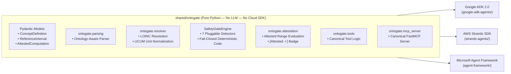
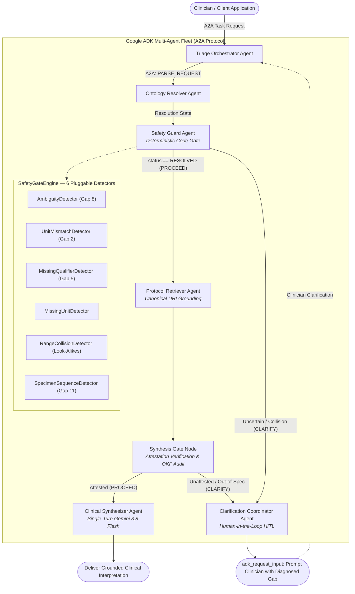
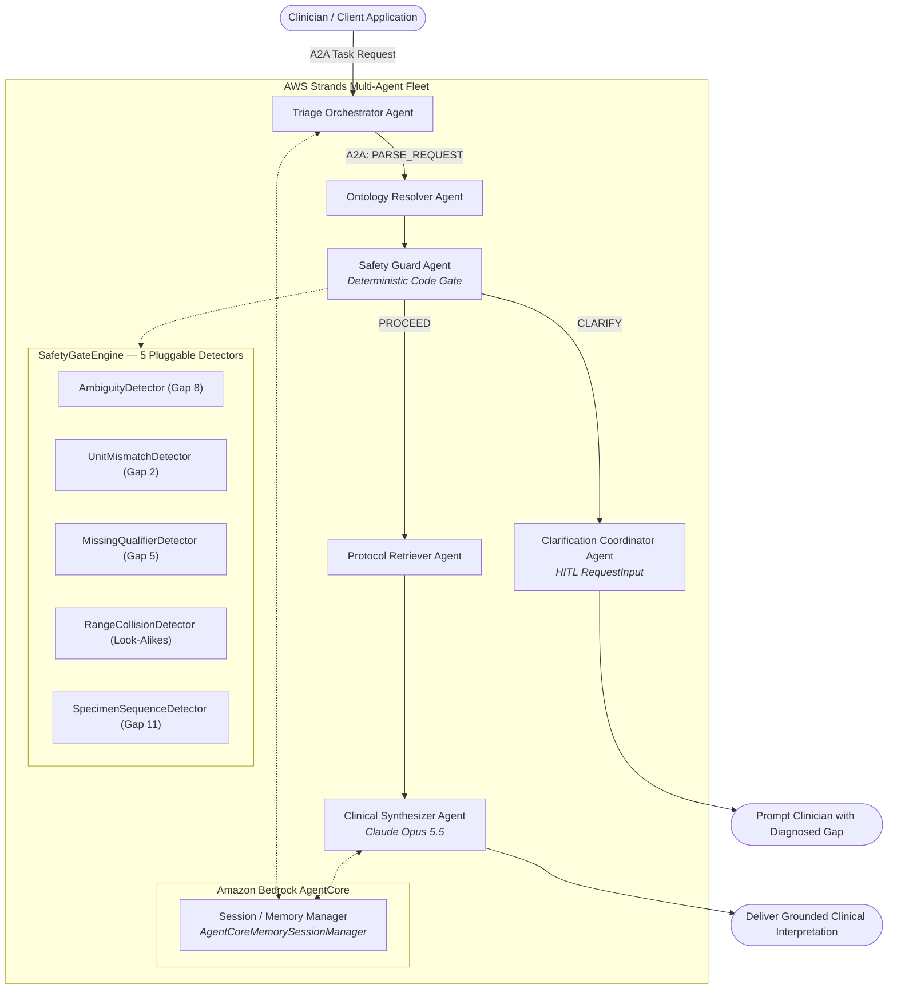
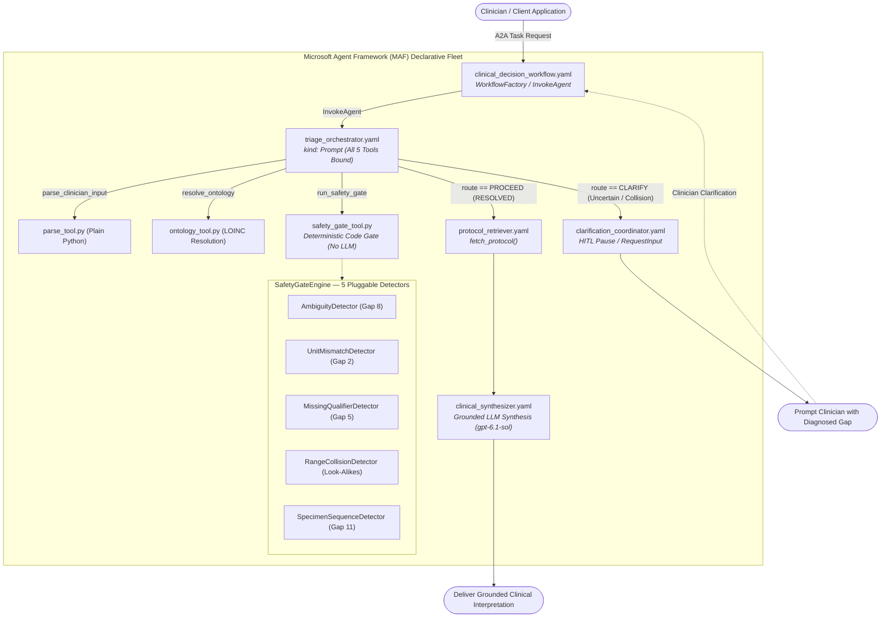
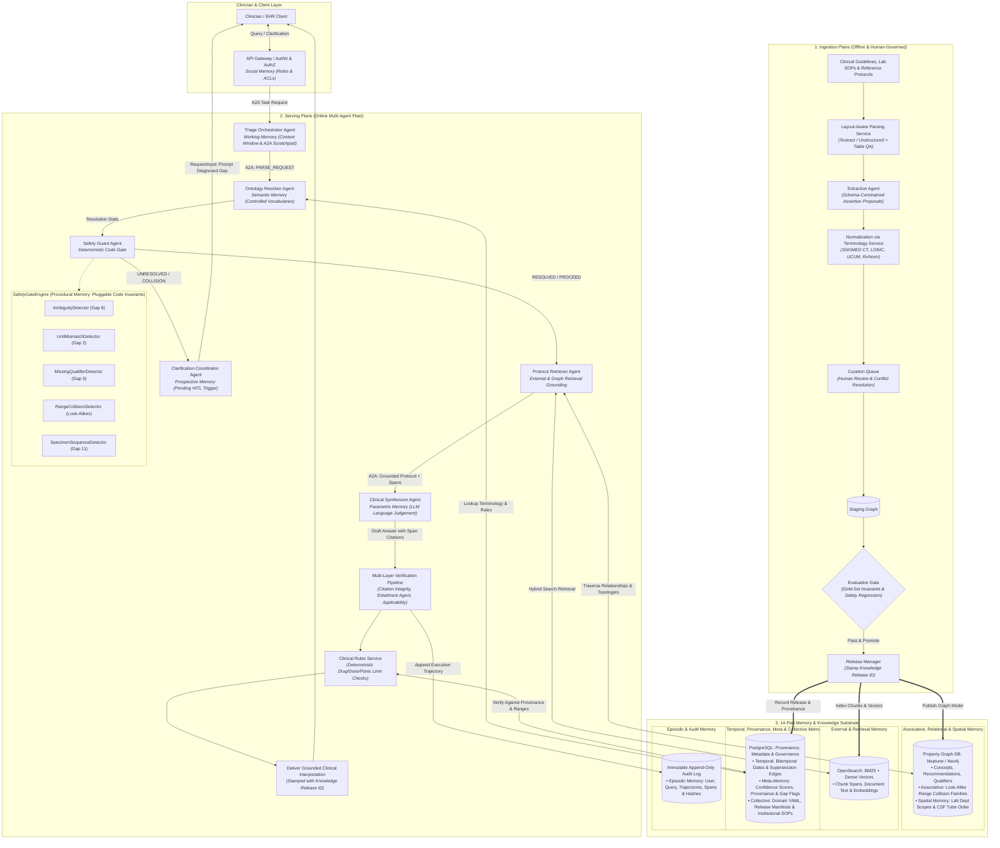
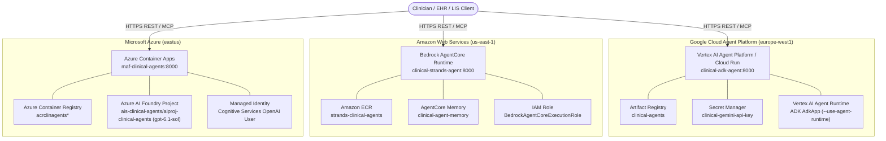

# Clinical Decision Support — Multi-Agent Retrieval-Gap System

*When the Retriever Has to Decide: Reusable Multi-Agent Architecture, Configurable Gaps, and Deterministic Gating*

By Dr. Amit Puri · October 2026

> **In continuation to:** *[Information Retrieval Part I](https://www.linkedin.com/pulse/information-retrieval-dr-amit-puri-ahcec/)*, *[Part II: When Similarity Isn't Enough!](https://www.linkedin.com/pulse/information-retrieval-when-similarity-isnt-enough-dr-amit-puri-2rnzc/)*, and *[Recap & Closing](https://www.linkedin.com/pulse/recap-where-retrieval-gaps-diagnose-fix-dr-amit-puri-fhlwf)*.

---

## Executive Summary & TL;DR

- **An agent is a retriever that has to decide.** Every one of the 7 classical/RAG retrieval gaps still applies. Agents introduce four new failure modes: guessing instead of asking (Gap 8), safety rules relegated to probabilistic prompts (Gap 9), un-evaluated execution trajectories (Gap 10), and tool output treated as unscoped, trusted context (Gap 11).
- **An ontology's job in an agent is to define what a term means, and when to stop.** In laboratory medicine, terms like `"Hb"`, `"Calcium"`, `"CSF panel"`, and `"Troponin"` each conceal multiple distinct assays with different clinical units, reference ranges, or owning laboratory departments.
- **Same clinical logic, three agent frameworks.** The deterministic `SafetyGateEngine`, Pydantic models, YAML config, and A2A contracts are framework-independent and centralized in the shared `ontogate` package (`shared/`). Three complete agent framework implementations demonstrate portability:

| Framework / Component | Folder | Model | Production Target | Status |
| :--- | :--- | :--- | :--- | :--- |
| **Shared Core (`ontogate`)** | `shared/` | Pure Python / Deterministic Gate / FastMCP | Framework-Agnostic Core (`ontogate` v1.0.0) | ✅ Complete |
| **Google ADK ≥2.11.0** | `google-adk-agents/` | Gemini 3.8 Flash | Google Cloud Agent Platform / Cloud Run | ✅ Complete |
| **AWS Strands Agents SDK + Bedrock AgentCore** | `strands-agents/` | Anthropic Claude Opus 5.5 | AWS Bedrock AgentCore / ECS Fargate | ✅ Complete |
| **Microsoft Agent Framework (MAF) / Azure AI Foundry** | `agent-framework/` | `gpt-6.1-sol` via Azure AI Foundry / OpenAI | Azure Container Apps + AI Foundry | ✅ Complete |
| **Multi-Cloud Deployment Automation** | `deployment/` | Multi-Cloud Agent Fleet | GCP, AWS & Azure (Bash & PowerShell) | ✅ Complete |

> [!TIP]
> The objective is not to find a universally "perfect" agent architecture, but to pinpoint **what failed**, **why it failed**, and **the smallest intervention that fixes it**.

---

## Repository Layout

```text
multiagent-retrieval-gaps/
│
├── shared/                              # ── Shared Core: Framework-Agnostic Ontology & Gate ──
│   ├── pyproject.toml                   # ontogate v1.0.0 package specification (pip installable)
│   ├── pytest.ini                       # Test configuration (pythonpath = . ontogate)
│   ├── ontogate/                        # Shared ontogate library (pure Python, zero cloud SDK deps)
│   │   ├── models.py                    # Pydantic schemas (TrustTier, ConceptDefinition, etc.)
│   │   ├── config.py                    # YAML pack loader & OntologyRegistry
│   │   ├── paths.py                     # Repository root & knowledge artifact discovery
│   │   ├── parsing.py                   # Ontology-aware clinician input parsing
│   │   ├── clarify.py                   # Deterministic clinical clarification generation
│   │   ├── resolver.py                  # LOINC concept resolution & semantic mapping
│   │   ├── units.py                     # Canonical UCUM unit checks & conversions
│   │   ├── concept_graph.py             # Concept graph traversal, look-alikes & protocols
│   │   ├── okf_index.py                 # Progressive disclosure catalog index (OKF §7.1)
│   │   ├── okf_writer.py                # Knowledge writeback & log.md maintenance
│   │   ├── attestation.py               # Deterministic numeric range attestation (OKF §5.4)
│   │   ├── catalog.py                   # Model catalog loader (config/models.yaml)
│   │   ├── tools.py                     # Canonical clinical tool contract implementations
│   │   ├── mcp_server.py                # FastMCP server (the 7 canonical clinical tools)
│   │   ├── validate.py                  # Ontology integrity & schema validation rules
│   │   ├── ports.py                     # Runtime ports (audit, telemetry, stores)
│   │   ├── release.py                   # Knowledge release build (`ontogate build`) & verification
│   │   ├── roles.py                     # Role specs (agents/<role>.yaml)
│   │   ├── skills.py                    # Skills render, lint, role checks, lock, archives, per-role resolution
│   │   ├── skill_refs.py                # Skill references rendered from the ontology (templates/skills/)
│   │   ├── cloud_stores.py              # Content-addressed skill stores: GCS, S3, Azure Blob, local
│   │   ├── rdf_export.py                # SKOS/OWL/PROV export, SHACL validation, OWL 2 RL, bundle
│   │   ├── cli.py                       # `ontogate` command line (validate, skills, rdf, build)
│   │   └── detectors/                   # 7 pluggable deterministic gap detectors + SafetyGateEngine
│   │       ├── engine.py                # SafetyGateEngine (deterministic gate, fail-closed)
│   │       ├── ambiguity.py             # AmbiguityDetector (Gap 8)
│   │       ├── unit_mismatch.py         # UnitMismatchDetector (Gap 2)
│   │       ├── missing_qualifier.py     # MissingQualifierDetector (Gap 5)
│   │       ├── missing_unit.py          # MissingUnitDetector
│   │       ├── range_collision.py       # RangeCollisionDetector (Look-Alikes)
│   │       ├── specimen_sequence.py     # SpecimenSequenceDetector (Gap 11)
│   │       └── population_context.py    # PopulationContextDetector
│   └── tests/                           # gate, CQs, validator, skills, RDF/SHACL, stores, packaging
│
├── ontology/                            # ── Clinical Knowledge Packs & Upper Ontology ─────────
│   ├── core/                            # Upper ontology schema, meta-models & SHACL shapes
│   │   ├── core.yaml                    # Upper ontology (units, dimensions, relations, facets)
│   │   └── shapes.ttl                   # SHACL: intervals, look-alikes, designations, sequencing, provenance, roles/skills/tools
│   ├── domains/laboratory_medicine/     # Laboratory medicine primary domain pack
│   │   ├── domain.yaml                  # Domain specification, version & author metadata
│   │   ├── vocabulary.yaml              # Synonyms & clinical aliases mapped to canonical IRIs
│   │   ├── analytes.yaml                # Primary analytes (Hb, Calcium, Troponin, CSF)
│   │   ├── observables.yaml             # Observable definitions, LOINC codes, UCUM units
│   │   ├── facets.yaml                  # Clinical qualifiers (total, ionized, arterial, venous)
│   │   ├── intervals.yaml               # Reference & critical intervals across populations
│   │   ├── panels.yaml                  # Multi-analyte panels (CSF emergency workup, etc.)
│   │   ├── protocols.yaml               # Clinical protocols & emergency escalation rules
│   │   └── designations.yaml            # Display names & terminology bindings
│   └── domains/cardiology/              # Cardiology second-domain reuse proof (P13.8)
│       ├── domain.yaml                  # Cardiology domain specification
│       ├── vocabulary.yaml              # Controlled departments & specimens
│       ├── analytes.yaml                # Troponin I, Troponin T, BNP, hsCRP
│       ├── observables.yaml             # LOINC concepts & confusable_with symmetric pairs
│       ├── facets.yaml                  # Population facet declarations
│       ├── intervals.yaml               # Reference intervals (unvalidated demonstration)
│       ├── protocols.yaml               # Grounded ESC & ACC/AHA clinical guidelines
│       └── designations.yaml            # Look-alike designations (cTn ambiguity)
│
├── skills/                              # ── Multi-Agent Runtime & Domain Skills (agentskills.io)
│   ├── runtime/                         # 6 role-scoped clinical agent skills
│   │   ├── clarification-dialogue/      # SKILL.md for clarification coordinator role
│   │   ├── clinical-triage/             # SKILL.md for triage orchestrator role
│   │   ├── grounded-synthesis/          # SKILL.md for clinical synthesizer role
│   │   ├── lab-term-resolution/         # SKILL.md for ontology resolver role
│   │   ├── protocol-retrieval/          # SKILL.md for protocol retriever role
│   │   └── specimen-sequencing/         # SKILL.md for panel coordinator role
│   ├── domains/                         # One orientation skill per domain pack
│   │   ├── domain-laboratory-medicine/  # references/ rendered from the laboratory medicine pack
│   │   └── domain-cardiology/           # references/ rendered from the cardiology pack
│   └── skills.lock.json                 # Content + archive SHA-256 per skill, and the bundle hash
│
├── agents/                              # ── Declarative Role Specifications ───────────────────
│   ├── clarification_coordinator.yaml   # Tools, skills, model tier & base prompt
│   ├── clinical_synthesizer.yaml        # Synthesis role specification
│   ├── ontology_resolver.yaml           # Term resolution role specification
│   ├── panel_coordinator.yaml           # Panel sequencing role specification
│   ├── protocol_retriever.yaml          # Protocol retrieval role specification
│   ├── safety_guard.yaml                # Code node: uses_model false, no skills
│   └── triage_orchestrator.yaml         # Triage coordination role specification
│
├── knowledge/                           # ── Knowledge Base Audit & Change Tracking ────────────
│   └── log.md                           # Append-only TBox ontology mutation log (OKF §7.5)
│
├── config/                              # Declarative runtime configuration
│   ├── models.yaml                      # Model catalog mapping framework roles to LLMs
│   └── scenarios/                       # Clinical evaluation scenarios & overlays
│       ├── scenario_a_hemoglobin.yaml   # Hb ambiguity & unit mismatch (Gap 2 & 8)
│       ├── scenario_b_csf_panel.yaml    # CSF emergency panel tube ordering (Gap 11)
│       ├── scenario_c_calcium_collision.yaml # Calcium look-alike range collision
│       ├── scenario_d_troponin.yaml     # Dynamic extension: Troponin I vs T (zero-code)
│       ├── scenario_e_glucose_specimen.yaml # Glucose specimen facet overlay
│       └── scenario_f_cardiology_troponin.yaml # Cardiology pack CQs (second-domain reuse)
│
├── deployment/                          # ── Multi-Cloud Production Deployment Automation ─────
│   ├── README.md                        # Multi-cloud deployment guide (GCP, AWS, Azure)
│   ├── IMPLEMENTATION_PLAN.md           # Architecture, security & provisioning specification
│   ├── teardown.py                      # Ledger-driven teardown: deletes what a deploy created (all clouds)
│   ├── gcloud-scripts/                  # Google Cloud Agent Platform / Cloud Run
│   │   ├── config.env                   # Project ID, region (europe-west1), service config
│   │   ├── deploy.sh / deploy.ps1       # Release build + skill publish, Cloud Run, optional Agent Runtime
│   │   ├── agent_runtime.py             # ADK AdkApp → Vertex AI Agent Runtime (--dry-run offline check)
│   │   ├── destroy.sh / destroy.ps1     # Clean resource teardown
│   │   └── test-service.sh / .ps1       # End-to-end integration & health verification
│   ├── aws-scripts/                     # AWS Bedrock AgentCore / ECS Fargate
│   │   ├── config.env                   # AWS region (us-east-1), AgentCore config
│   │   ├── deploy.sh / deploy.ps1       # Automated Bedrock AgentCore & IAM provisioning
│   │   ├── destroy.sh / destroy.ps1     # Clean resource teardown
│   │   └── test-service.sh / .ps1       # End-to-end integration & health verification
│   └── az-scripts/                      # Azure Container Apps + AI Foundry
│   │   ├── config.env                   # Azure region (eastus), AI Foundry project config
│   │   ├── deploy.sh / deploy.ps1       # Keyless Managed Identity + ACA deployment
│   │   ├── destroy.sh / destroy.ps1     # Clean resource teardown
│   │   └── test-service.sh / .ps1       # End-to-end integration & health verification
│
├── google-adk-agents/                   # ── Framework 1: Google ADK 2.0 ──────────────────────
│   ├── README.md                        # Framework 1 documentation, OKF v0.2 & Harness details
│   ├── Dockerfile                       # Cloud Run / GKE production container (port 8000)
│   ├── pytest.ini                       # pythonpath = . src ../shared
│   ├── src/
│   │   ├── .env                         # GEMINI_API_KEY (gitignored)
│   │   ├── env.example                  # Template
│   │   ├── a2a/contracts.py             # A2AMessage, AgentRole, A2AAction, A2ATaskState
│   │   ├── agents/                      # 6 specialized ADK agent roles (OKF trust-aware synthesis)
│   │   ├── harness/                     # Agent Harness — 4-step MCP continuous loop
│   │   │   ├── agent.py                 # Step 1: ClinicalADKHarness continuous reasoning loop
│   │   │   ├── mcp_server.py            # Step 2: FastMCP server (delegates to ontogate.mcp_server)
│   │   │   ├── mcp_client.py            # Step 2: Gemini function_call ↔ MCP bridge
│   │   │   ├── context.py               # Step 3: Token budgeting & OKF progressive disclosure
│   │   │   ├── session.py               # Step 3: Turn-by-turn conversation session state
│   │   │   ├── server.py                # Step 4: FastAPI ASGI server (REST + healthz + MCP tools)
│   │   │   └── console.py               # Step 4: Interactive CLI debugging console
│   │   ├── orchestration/a2a_orchestrator.py # ADK Workflow with OKF pre-scoping
│   │   ├── runner.py                    # Scenarios A–D runner (supports --harness flag)
│   │   ├── workflow.py                  # ADK workflow definition & safety guard node
│   │   ├── tools.py                     # Canonical tool bindings (delegates to ontogate.tools)
│   │   └── main.py                      # CLI entrypoint
│   ├── requirements.txt                 # google-adk, google-genai, mcp, fastapi, uvicorn
│   ├── load_env.sh
│   └── tests/                           # gate, OKF, harness, role-skill & Agent Runtime packaging tests
│
├── strands-agents/                      # ── Framework 2: AWS Strands Agents SDK ──────────────
│   ├── README.md                        # Framework 2 documentation & AgentCore memory details
│   ├── Dockerfile                       # ECS / App Runner production container (port 8000)
│   ├── pytest.ini                       # pythonpath = . src ../shared
│   ├── requirements.txt
│   ├── .env.example                     # Bedrock / AgentCore template
│   ├── src/
│   │   ├── .env                         # ANTHROPIC_API_KEY + ANTHROPIC_MODEL_ID (gitignored)
│   │   ├── env.example
│   │   ├── server.py                    # Production FastAPI ASGI server (REST + healthz + MCP tools)
│   │   ├── models/provider.py           # AnthropicModel (claude-opus-5-5) or BedrockModel
│   │   ├── a2a/contracts.py             # Shared A2A contracts (same schema as ADK)
│   │   ├── agents/                      # 6 Strands agent roles
│   │   ├── memory/session.py            # Bedrock AgentCore managed session / local fallback
│   │   ├── orchestration/               # Strands workflow coordinator
│   │   ├── tools/                       # Strands @tool wrappers over ontogate.tools
│   │   ├── runner.py                    # Scenarios A–D runner
│   │   └── main.py                      # CLI entrypoint
│   └── tests/                           # deterministic offline, invariant & role-skill tests
│
├── agent-framework/                     # ── Framework 3: Microsoft Agent Framework (MAF) ────
│   ├── README.md                        # Framework 3 documentation & declarative workflow details
│   ├── Dockerfile                       # Azure Container Apps production container (port 8000)
│   ├── pytest.ini                       # pythonpath = . src ../shared
│   ├── requirements.txt
│   ├── load_env.sh
│   ├── declarative-agents/              # kind: Prompt YAML, GENERATED from agents/<role>.yaml
│   │   ├── triage_orchestrator.yaml     # parse → resolve → gate
│   │   ├── ontology_resolver.yaml       # LOINC concept resolution
│   │   ├── protocol_retriever.yaml      # URI-bound protocol retrieval
│   │   ├── clinical_synthesizer.yaml    # Grounded synthesis (only after PROCEED)
│   │   ├── clarification_coordinator.yaml # HITL clarification
│   │   └── panel_coordinator.yaml       # Specimen sequencing (the safety guard is code, not a prompt agent)
│   ├── declarative-workflows/
│   │   └── clinical_decision_workflow.yaml # WorkflowFactory + InvokeAgent conditional routing
│   ├── src/
│   │   ├── .env                         # Azure / OpenAI credentials (gitignored)
│   │   ├── env.example
│   │   ├── a2a/contracts.py             # Shared A2A contracts (parity with ADK & Strands)
│   │   ├── harness/                     # MAF Agent Harness
│   │   │   ├── agent.py                 # ClinicalHarnessAgent + create_clinical_harness_agent()
│   │   │   ├── session.py               # HarnessSession — per-turn history & state
│   │   │   ├── server.py                # Production FastAPI ASGI server (REST + healthz + MCP tools)
│   │   │   ├── providers.py             # ClinicalTodoProvider, ClinicalModeProvider, SafetyGateApprovalPolicy
│   │   │   └── console.py               # Terminal UX — /todos /mode /scenario /status
│   │   ├── tools/                       # Plain Python tool wrappers over ontogate.tools
│   │   ├── declarative.py               # Role spec → declarative YAML generator (--check in CI)
│   │   ├── skills_loader.py             # Role-scoped SkillsProvider (context provider)
│   │   ├── models/provider.py           # Credential auto-detection (Foundry, Azure OpenAI, OpenAI)
│   │   ├── orchestration/workflow_runner.py # Live MAF workflow + offline fast path
│   │   ├── runner.py                    # Scenarios A–D runner
│   │   └── main.py                      # CLI entrypoint (--harness, --harness-scenario)
│   └── tests/                           # safety invariants, harness, declarative drift & skills tests
│
├── conformance/                         # Cross-cloud parity: every CQ through ADK, Strands & MAF wrappers
├── docs/                                # Architectural blueprints, OKF specs, memory models & decision models tracking
├── run-all-tests.sh                     # Integrity, skills, SHACL, generated-file drift, all suites, conformance
├── run-all.sh                           # Runs all 4 clinical scenarios across all 3 frameworks
└── .gitignore
```

> [!IMPORTANT]
> **`ontology/` and `config/`** provide the single source of truth for all clinical knowledge and scenarios. All three framework
> implementations read from the same `ontology/domains/` and `config/scenarios/` YAML files through the shared
> **`ontogate`** library (`shared/`) — no Python code changes are needed to add a new gap scenario.

---

## Gaps Addressed

| Gap | Level | Addressed In | Implementation |
| :--- | :--- | :--- | :--- |
| **Gap 2: Unit Mismatch** | Agent Loop | `shared/ontogate/detectors/unit_mismatch.py` | Standalone detector that explicitly rejects units not valid for any matched concept (e.g. `mg/dL` for Hemoglobin). |
| **Gap 5: Missing Qualifier** | Agent Loop | `shared/ontogate/detectors/missing_qualifier.py` | Flags numeric results in look-alike assay families (Calcium, Troponin) when no qualifier is supplied. |
| **Gap 8: Ambiguity & Silent Guessing** | Agent Loop | `shared/ontogate/detectors/ambiguity.py` | Returns explicit `AMBIGUOUS`, `UNIT_MISMATCH`, or `NOT_FOUND` statuses instead of silent guesses. |
| **Gap 9: Safety Rule in Prompt** | Agent Loop | `shared/ontogate/detectors/engine.py` | Deterministic routing `SafetyGateEngine` and `safety_guard_node`; fails closed on uncertainty. Human-in-the-loop pause. |
| **Gap 10: Trajectory Never Evaluated** | Agent Loop | `shared/tests/`, `*/tests/` | Pure-code `pytest` suites and cross-cloud conformance verifying invariants without LLM calls. |
| **Gap 11: Tool Output Trusted, Unscoped** | Agent Loop | `shared/ontogate/detectors/specimen_sequence.py` | Enforces CSF panel tube sequencing and department scope boundaries. |
| **Range Collisions (Look-Alikes)** | Clinical Safety | `shared/ontogate/detectors/range_collision.py` | Evaluates numeric values against look-alike assay families to prevent lethal classification errors. |
| **Dynamic Gap Extensibility** | Framework | `config/scenarios/` | New gaps declared entirely in YAML — zero changes to Python code. |

---

## Shared Core — Framework-Agnostic Ontology & Gate (`shared/`)

The **`shared/`** directory contains **`ontogate`** (`ontogate` v1.0.0), a pure-Python, zero-cloud-dependency package that implements the deterministic core of the entire multi-agent system. All three agent frameworks (Google ADK, AWS Strands, and Microsoft Agent Framework) import and delegate to `ontogate`.

### Core Responsibilities



1. **Deterministic Safety Gating (Gap 9):**
   `SafetyGateEngine` executes 7 pluggable gap detectors in pure Python with **zero LLM calls** and **fail-closed routing** (only `RESOLVED` proceeds; `AMBIGUOUS`, `UNIT_MISMATCH`, `RANGE_COLLISION`, `NOT_FOUND` all route to `CLARIFY`).
2. **Canonical Data Models & Protocols:**
   Strict Pydantic v2 schemas (`ConceptDefinition`, `Observable`, `Facet`, `ReferenceInterval`, `ProtocolDefinition`, `AttestedComputation`).
3. **Ontology Pack Loading & Dynamic Scenarios:**
   Loads upper ontology (`ontology/core/core.yaml`), domain packs (`ontology/domains/laboratory_medicine/*.yaml`), and runtime scenario overlays (`config/scenarios/*.yaml`).
4. **Attested Numeric Computation (OKF §5.4):**
   Evaluates patient lab values against age/sex/qualifier reference intervals deterministically and stamps the `[Attested ✓]` compliance badge.
5. **Canonical FastMCP Tool Server:**
   Exposes the 7 canonical clinical decision-support tools via FastMCP:
   - `parse_clinician_input`
   - `resolve_lab_term`
   - `evaluate_safety_gate`
   - `fetch_grounded_protocol`
   - `attest_computation`
   - `build_clarification_prompt`
   - `panel_workup`

   `classify_lookalikes` is a read-only helper in `ontogate.tools` (not an MCP tool).
6. **Cross-Framework Consumption:**
   - **Local Dev / Testing:** Each framework includes `shared/` on `PYTHONPATH` (e.g. `pytest.ini` with `pythonpath = . src ../shared` and automatic discovery via `ontogate.paths`).
   - **Production Containers:** Dockerfiles install the package directly: `pip install "/tmp/shared[mcp]"`.

### Running Shared Core Invariant Tests

```bash
cd shared
python -m pytest tests/ -v
# 235 passed (pure Python, 0 LLM calls; the RDF/SHACL tests need `pip install -e ".[dev]"`)
```

---

## Knowledge Release, Runtime Skills & Cross-Cloud Conformance

Everything an agent knows or is told to do ships as one **knowledge release**,
built and verified offline before any deployment:

```bash
python -m ontogate validate              # integrity rules over the pack and every scenario overlay
python -m ontogate skills build          # render skill references from the ontology, lint, lock, archive
python -m ontogate rdf validate          # SHACL over the ontology + the role/skill/tool meta-graph
python -m ontogate build                 # all of the above + OWL 2 RL → dist/release/manifest.json
python conformance/run.py                # same decisions on ADK, Strands and MAF for every CQ
```

| Layer | Source of truth | Checked by |
| :--- | :--- | :--- |
| **Ontology** | `ontology/core`, `ontology/domains/<pack>` | integrity rules, SHACL (`ontology/core/shapes.ttl`), 35 competency questions |
| **Formal view** | generated: SKOS / SKOS-XL / OWL 2 / PROV-O (`ontogate.rdf_export`) | SHACL; OWL 2 RL materialises symmetric and inverse relations |
| **Role specs** | `agents/<role>.yaml` (tools, skills, `domain_skills`, model tier, instruction) | role ↔ skill ↔ tool consistency (lint + SHACL `RoleSkillShape`) |
| **Runtime skills** | `skills/runtime/*`, `skills/domains/domain-<pack>` | agentskills.io format, clinical lint (no numbers, no routing, no scripts), lock drift |
| **Skill references** | rendered from the ontology (designations, facets, trust caveats, panels) | `ontogate skills check` fails if a reference differs from the ontology |
| **Release** | `skills.lock.json` (content + archive hashes, bundle hash), `dist/release/manifest.json` | runtimes verify hashes at startup and fail closed |

**Runtime skills per framework.** Each role loads exactly its skills through the
framework's native loader, built from the same hash-verified directories:
ADK `SkillToolset` (script tool filtered out), Strands `AgentSkills` (local
`Skill` instances, `strict=True`) and MAF `SkillsProvider` (no script
extensions). `safety_guard` is a code node with no model and no skills. A role
with `domain_skills: true` loads the domain skill of whichever pack is served,
so the cardiology pack needed no role-spec change.

**Skill stores.** `ontogate skills publish gs://… | s3://… | azblob://…`
uploads content-addressed archives (`<name>/<archive_sha256>.zip`); setting
`ONTOGATE_SKILL_STORE` makes a runtime materialise and hash-verify them at
startup instead of using the copies baked into the image.

**Conformance.** `conformance/run.py` runs every competency question (both
packs) through each framework's own tool wrappers in a separate process and
fails on any difference from the canonical `ontogate` decision — status, route,
resolved URI, candidates, readings, attestation and panel order.

---

## Framework 1 — Google ADK ≥2.11.0 (`google-adk-agents/`)

### Multi-Agent Architecture



### Getting Started — Google ADK

```bash
# 1. Install dependencies
cd google-adk-agents
pip install -r requirements.txt

# 2. Configure API key
cp src/env.example src/.env
# Edit src/.env: set GEMINI_API_KEY="..."

# 3. Run all scenarios (live Gemini 3.8 Flash, ADK workflow)
python src/main.py

# 4. Offline / stub mode (no API key needed)
python src/main.py --offline

# 5. Run all scenarios via Agent Harness (FastMCP + continuous loop)
python src/runner.py --harness
python src/runner.py --harness --offline

# 6. Interactive Agent Harness CLI console
python -m src.harness.console --offline
# clinician> Hb 13.5 | g/dL    → [PROCEED] loinc:718-7 | Ref: 13.8–17.2 g/dL [Attested ✓]
# clinician> Calcium 4.8 mg/dL → [CLARIFY] RANGE_COLLISION: Total vs. Ionized

# 7. Start production REST server (FastAPI / ASGI)
uvicorn src.harness.server:app --host 0.0.0.0 --port 8000
# POST /api/v1/query  GET /api/v1/mcp/tools  GET /healthz  GET /readyz

# 8. Run tests (193 deterministic safety invariants, OKF & harness tests)
python -m pytest tests/ -v
```

> [!TIP]
> See [`google-adk-agents/README.md`](google-adk-agents/README.md) for detailed documentation of the Google ADK 2.0 multi-agent implementation and Open Knowledge Format (OKF v0.2) enhancements.


---

## Framework 2 — AWS Strands Agents SDK + Bedrock AgentCore (`strands-agents/`)

### Multi-Agent Architecture



### Model Selection

| Mode | Model ID | Trigger |
| :--- | :--- | :--- |
| **Local / Direct Anthropic** | `claude-opus-5-5` | `ANTHROPIC_API_KEY` set in `src/.env` |
| **AWS Bedrock** | `global.anthropic.claude-opus-5-5` | `AWS_REGION` + credentials, `ANTHROPIC_API_KEY` unset |
| **Offline / Mock** | `MockBedrockModel` | `STRANDS_OFFLINE_MODE=true` or no credentials |

### Getting Started — Strands Agents

#### Option A: Local run with Anthropic API key (simplest)

```bash
cd strands-agents

# 1. Install dependencies
pip install -r requirements.txt

# 2. Verify src/.env (key is shared from google-adk-agents):
#    ANTHROPIC_API_KEY="sk-ant-..."
#    ANTHROPIC_MODEL_ID="claude-opus-5-5"
cat src/.env

# 3. Run all scenarios (live Claude Opus 5.5 via direct Anthropic API)
python src/main.py

# 4. Offline mode (no API key needed, deterministic mock)
python src/main.py --offline

# 5. Run tests (54 deterministic offline invariants, ~7.8 s)
python -m pytest tests/ -v

# 6. Start production REST server (FastAPI / ASGI on port 8000)
uvicorn src.server:app --host 0.0.0.0 --port 8000
# POST /api/v1/query  GET /api/v1/mcp/tools  GET /healthz  GET /readyz
```

> [!TIP]
> See [`strands-agents/README.md`](strands-agents/README.md) for detailed documentation of the AWS Strands Agents SDK implementation, supervisor orchestration, and Amazon Bedrock AgentCore memory management.


#### Option B: AWS Bedrock (cross-region inference profile)

```bash
export AWS_REGION=us-east-1
export AWS_PROFILE=your-profile
export BEDROCK_MODEL_ID=global.anthropic.claude-opus-5-5
unset ANTHROPIC_API_KEY   # let Bedrock auto-discovery take over
python src/main.py
```

#### Option C: Bedrock AgentCore managed memory (production)

```bash
# Add to strands-agents/src/.env:
# AGENTCORE_MEMORY_ID=mem-clinical-decision-support
# AGENTCORE_SESSION_ID=session-default
# AGENTCORE_ACTOR_ID=clinician-001
# STRANDS_OFFLINE_MODE=false
python src/main.py
```

> [!NOTE]
> `ANTHROPIC_API_KEY` in `src/.env` takes precedence over AWS auto-discovery.
> Unset it to switch to Bedrock. The Strands SDK logs a reminder when both are present.

---

## Framework 3 — Microsoft Agent Framework (MAF) / Azure AI Foundry (`agent-framework/`)

### Multi-Agent Architecture (Declarative YAML + WorkflowFactory)



### Key Design Highlights — Microsoft Agent Framework

- **Declarative Agents (`kind: Prompt` YAML)**: 6 declarative agents defined entirely in `declarative-agents/*.yaml`, separating prompt instructions and tool declarations from execution logic.
- **Declarative Workflows (`WorkflowFactory`)**: Structured in `declarative-workflows/clinical_decision_workflow.yaml` using MAF conditional routing (`InvokeAgent` + `If/Then/Else`).
- **Plain Python Tools (Zero Decorator Overhead)**: Plain Python functions bound via YAML `bindings:` without mandatory `@tool` or `@kernel_function` decorators.
- **Fail-Closed Code Safety Gate**: `SafetyGateEngine` runs pure deterministic Python before any synthesis model invocation (closing Gap 9).
- **Namespace-Safe Core Shim**: Pre-registers shared ADK core modules via `importlib.util` in `sys.modules`, achieving zero-duplication code reuse across frameworks without namespace collisions.

### Credential Modes & Priority

| Priority | Mode | Environment Variable | Target Environment |
| :--- | :--- | :--- | :--- |
| **1** | **Azure AI Foundry** | `AZURE_AI_FOUNDRY_PROJECT_ENDPOINT` | Production cloud deployment (`gpt-6.1-sol`) |
| **2** | **Azure OpenAI Direct** | `AZURE_OPENAI_ENDPOINT` + `AZURE_OPENAI_DEPLOYMENT` | Direct Azure tenant resource |
| **3** | **OpenAI Agents SDK** | `OPENAI_API_KEY` | Local development & rapid prototyping |
| **4** | **Deterministic Offline** | `MAF_OFFLINE_MODE=true` | Fast invariant CI/CD (0 API calls, ~1 s) |

### Getting Started — Microsoft Agent Framework

```bash
# 1. Install dependencies
cd agent-framework
pip install -r requirements.txt

# 2. Configure credentials (or use included local key in src/.env)
cp src/env.example src/.env

# 3. Run all scenarios (live gpt-6.1-sol)
python src/main.py

# 4. Offline mode (no API key needed, deterministic mock)
python src/main.py --offline

# 5. Run a single scenario via WorkflowFactory runner
python src/main.py --scenario A   # Hb 13.5 — ambiguity, unit mismatch, resolution
python src/main.py --scenario B   # CSF emergency panel — tube ordering (Gap 11)
python src/main.py --scenario C   # Calcium 4.8 — look-alike collision
python src/main.py --scenario D   # Troponin I vs T — dynamic extension

# 6. Launch the interactive MAF Agent Harness console
python src/main.py --harness
# clinician> Hb 13.5 | g/dL    → [PROCEED] loinc:718-7 | Ref: 13.8–17.2 g/dL
# clinician> /todos             → 4-step diagnostic workflow checklist
# clinician> /mode plan         → switch to PLAN mode (analysis only, no protocol fetch)
# clinician> /scenario A        → run Scenario A through the harness
# clinician> /status            → session ID, mode, registered tools

# 7. Run a scenario non-interactively through the Harness
python src/main.py --harness-scenario A
python src/main.py --harness-scenario all

# 8. Start production REST server (FastAPI / ASGI on port 8000)
uvicorn src.harness.server:app --host 0.0.0.0 --port 8000
# POST /api/v1/query  GET /api/v1/mcp/tools  GET /healthz  GET /readyz

# 9. Run test suite (44 deterministic safety invariants, ~1.2 s)
python -m pytest tests/ -v
```

---

## The Demonstration Scenarios

All four scenarios are declared as **declarative YAML** under `config/scenarios/` — shared across all frameworks.

### Scenario A: "Hb 13.5" — Same Label, Different Departments
- **Problem:** `"Hb 13.5"` without unit → CBC Hemoglobin (`13.5 g/dL` = borderline normal) or Glycated Hemoglobin (`13.5%` = severe diabetic emergency).
- **Resolution:** `AmbiguityDetector` → `RequestInput` asking for unit. `g/dL` → LOINC `718-7`; `mg/dL` → `UNIT_MISMATCH`.

### Scenario B: CSF Emergency Panel — One Specimen, Many Owners
- **Problem:** Single Lumbar Puncture must be partitioned across 3 departments without cross-contamination.
- **Resolution:** `SpecimenSequenceDetector` pre-scopes by tube: Tube 1 (Biochem), Tube 2 (Micro), Tube 3 (Haematology).

### Scenario C: Calcium 4.8 mg/dL — Look-Alike Range Collision
- **Problem:** Total Calcium at 4.8 = `CRITICAL_LOW` (emergency IV calcium); Ionized Calcium at 4.8 = `NORMAL`.
- **Resolution:** `RangeCollisionDetector` → `RANGE_COLLISION` → forced clarification before medication.

### Scenario D: Troponin I vs T — Zero-Code Extension
- **Problem:** `"Troponin 15"` — cTnI in `ng/mL` (critical > 0.40) vs hs-cTnT in `ng/L` (critical > 52). Wrong unit = false alarm catheterization or missed MI.
- **Resolution:** Declared entirely in `scenario_d_troponin.yaml` — zero Python code. Full multi-agent A2A fleet.

---

## Trajectory Evaluation — Closing Gap 10 & Unified Run Scripts

Pure-code deterministic `pytest` suites verify safety invariants **without LLM calls**:

```bash
# Shared Core (ontogate) — 235 tests (gate, CQs, validator, skills, roles, RDF/SHACL, stores, AgentCards, A2A)
cd shared && python -m pytest tests/ -v

# Google ADK ≥2.11.0 — 206 tests
cd google-adk-agents && python -m pytest tests/ -v

# AWS Strands SDK — 77 tests
cd strands-agents && python -m pytest tests/ -v

# Microsoft Agent Framework (MAF) — 50 tests
cd agent-framework && python -m pytest tests/ -v

# Cross-cloud conformance — 35 CQs × 3 frameworks, AgentCards, live runner per server
python -m pytest conformance

# Deployment teardown and answer graders
python -m pytest deployment/tests
python -m pytest evals
```

### One-Command Unified Execution Scripts

From the repository root, run the entire multi-cloud agent fleet and test suites using the top-level bash scripts:

```bash
# 1. Integrity, skills, SHACL, generated-file drift, every suite and cross-cloud conformance
sh run-all-tests.sh

# 2. Run end-to-end multi-agent clinical scenarios A–D across all 3 frameworks
sh run-all.sh
```

#### Verified Multi-Framework Execution Highlights (`run-all.sh`)

| Framework | Orchestration & Synthesis Mode | Scenario Highlights & Behavioral Verification |
| :--- | :--- | :--- |
| **Google ADK 2.0** | Live Gemini 3.8 Flash (`gemini-3.8-flash`) | • **Scenario A**: Turn 1 (`Hb 13.5` no unit) pauses deterministically with `status=AMBIGUOUS` (`route=CLARIFY`). Turn 2 (`Hb 13.5 \| g/dL`) resolves to `loinc:718-7`, fetching reference range 13.8–17.2 g/dL with `[Attested ✓]` badge. Turn 3 (`Hb 13.5 \| mg/dL`) triggers `status=UNIT_MISMATCH` (`route=CLARIFY`).<br>• **Scenario B**: CSF Emergency Panel strictly enforces tube sequence: Tube 1 (Biochemistry), Tube 2 (Microbiology), Tube 3 (Hematology).<br>• **Scenario C**: `Calcium 4.8 mg/dL` triggers `RANGE_COLLISION` (`CLARIFY`); qualifying as `total` yields `CRITICAL_LOW`, whereas `ionized` yields `NORMAL`.<br>• **Scenario D**: Troponin I vs T dynamic YAML extension resolves `Troponin 15 \| ng/L` to `loinc:6598-7` (hs-cTnT) with panic limits (> 52 ng/L). |
| **AWS Strands SDK + Bedrock AgentCore** | Anthropic Claude on AWS Bedrock (`claude-opus-5-5`) | • Full A2A supervisor orchestration with Bedrock AgentCore memory session manager.<br>• Resilient fallback to deterministic offline pipeline if cloud API quotas or rate limits are reached.<br>• Identical scenario outcomes: `AMBIGUOUS` on Turn 1, `RESOLVED` on Turn 2, and `UNIT_MISMATCH` on Turn 3. |
| **Microsoft Agent Framework (MAF)** | Live `gpt-6.1-sol` via OpenAI Agents SDK / Azure AI Foundry | • Declarative `kind: Prompt` agents and `WorkflowFactory` conditional routing.<br>• Identical clinical decisions: intercepts look-alike collisions (Calcium 4.8) and rejects incompatible units (`mg/dL` for Troponin). |

---

## A2A Message Contracts

All three implementations (ADK, Strands, and MAF) exchange the same structured `A2AMessage` envelopes:

```python
class A2AMessage(BaseModel):
    message_id: str
    trace_id: str
    sender: AgentRole       # triage_orchestrator, ontology_resolver_agent, …
    recipient: AgentRole
    action: A2AAction       # PARSE_REQUEST, RESOLVE_CONCEPT, VALIDATE_SAFETY, …
    timestamp: float
    payload: Dict[str, Any]
    status: Optional[ResolutionStatus] = None
```

---

## Production Architecture

### Proposed End-to-End System Architecture

The proposed production architecture integrates the **Offline Clinical Knowledge Ingestion & Governance Plane** ([`docs/healthcare_multi_agent_architecture.md`](./docs/healthcare_multi_agent_architecture.md)), the **Online Serving Plane with Deterministic Safety Gating**, and the **14-Part Memory Substrate** ([`docs/ai-agent-memory-architecture.md`](./docs/ai-agent-memory-architecture.md)).



---

### 14-Part Memory Architecture in Healthcare Multi-Agent Systems

Grounding the fourteen memory types from [`docs/ai-agent-memory-architecture.md`](./docs/ai-agent-memory-architecture.md) in this decision-support system:

| # | Memory Type | Implementation in Decision Support System | Failure Mode Mitigated |
|---|---|---|---|
| **1** | **Working (Context)** | Single-turn context window + typed `A2AMessage` payload scratchpads across the fleet. | Context rot; loss of active lab session constraints. |
| **2** | **Semantic** | Controlled clinical vocabularies, LOINC mappings, UCUM units, and approved concept definitions (`concepts.yaml`). | Semantic drift; inventing non-existent clinical codes. |
| **3** | **Episodic** | Session event logs, execution trajectories, and historical query resolutions. | Repeating past diagnostic failures or re-asking answered questions. |
| **4** | **Procedural** | Pluggable `SafetyGateEngine` detectors, A2A action contracts, skill recipes, and protocol resolution algorithms. | Blind replay of outdated runbooks or inconsistent gate execution. |
| **5** | **External (Retrieval)** | OpenSearch hybrid search (BM25 + dense vectors) over document chunks and evidence spans. | Hallucinating clinical literature not present in guidelines. |
| **6** | **Parametric** | Frozen weights of base foundation models (Gemini 3.8 Flash, Claude Opus 5.5, `gpt-6.1-sol` via Azure AI Foundry / OpenAI). | Answering changing clinical thresholds from stale training data. |
| **7** | **Prospective** | Pending clarification triggers in `ClarificationCoordinatorAgent` awaiting clinician input (`RequestInput`), async lab result hooks. | Unresolved clinical ambiguities left hanging or forgotten. |
| **8** | **Spatial** | Physical CSF lumbar puncture tube sequencing (Tubes 1–3) and owning laboratory department boundaries (Biochemistry, Microbiology, Haematology). | Specimen cross-contamination; dispatching tests to the wrong lab department. |
| **9** | **Temporal** | Bitemporal records (`valid_from`/`valid_to` vs. `recorded_at`), explicit `[:SUPERSEDES]` graph edges, and guideline expiration dates. | Recommending obsolete or superseded clinical guidelines. |
| **10** | **Associative / Relational** | Property graph (Neptune/Neo4j) linking Concepts, Recommendations, Qualifiers, Evidence Chunks, and Look-Alike Collision Families (Calcium, Troponin). | Treating numeric values in isolation without cross-assay collision awareness. |
| **11** | **Social** | Clinician role, department credentials, patient-caregiver relationship, and granular Document ACLs. | Leaking restricted clinical trial data or bypassing role authorization. |
| **12** | **Meta-Memory** | Confidence scores, span citation verification, gap detection status (`AMBIGUOUS`, `RANGE_COLLISION`), and retrievability gating. | Unearned certainty; guessing when information is incomplete (Gap 8). |
| **13** | **Collective / Organizational** | Governed `config/domains/` YAML knowledge base, institutional SOPs, panic limit definitions, and immutable `KnowledgeReleaseID`. | Inconsistent recommendations across clinical teams or facilities. |
| **14** | **Sensory (Perceptual)** | Short-lived raw multimodal buffers for lab instrument outputs, scanned PDF requisitions, and table OCR. | Prematurely discarding subtle assay flags or raw instrument metadata. |

---

### Architectural Planes & Interaction Flow

1. **Ingestion Plane (Offline & Human-Governed):**
   - Guidelines, SOPs, and manufacturer assay package inserts are processed through a layout-aware parsing pipeline.
   - An isolated, schema-constrained **Extraction Agent** proposes candidate assertions linked to exact text spans.
   - Assertions are normalized via the **Terminology Service** (SNOMED CT, LOINC, UCUM, RxNorm).
   - Clinical governance reviews high-risk claims and conflicts in the **Curation Queue**.
   - An **Evaluation Gate** runs gold-set regression invariants; on pass, a **`KnowledgeReleaseID`** is stamped and published across the graph, search index, and relational store.

2. **Serving Plane (Online Multi-Agent Fleet):**
   - Queries enter through the **API Gateway** where identity, role, and ACLs are established (Social Memory).
   - The **Triage Orchestrator** parses the clinical request and coordinates the fleet via typed `A2AMessage` contracts.
   - The **Ontology Resolver Agent** expands synonyms and maps clinical terms to canonical concepts.
   - The **Safety Guard Agent** runs the deterministic `SafetyGateEngine` in code (closing Gap 9). If any gap is detected (e.g. unit mismatch, look-alike collision, tube order violation), the flow halts immediately and routes to the **Clarification Coordinator Agent** (closing Gap 8).
   - Once validated, the **Protocol Retriever Agent** pulls grounded recommendations and evidence chunks from the knowledge substrate.
   - The **Clinical Synthesizer Agent** drafts the clinical interpretation with span-level citations.
   - The **Verification Pipeline & Clinical Rules Service** deterministically verifies citation integrity, entailment against source spans, population applicability, currency, and dose/panic thresholds.
   - The verified output is stamped with the `KnowledgeReleaseID` and delivered to the clinician, with a complete trajectory recorded in the immutable **Audit Log**.

---

### Technology Stack

| Layer | Google ADK | AWS Strands | Microsoft MAF / Azure AI Foundry |
| :--- | :--- | :--- | :--- |
| **Shared Core Library** | `ontogate` (`shared/`) | `ontogate` (`shared/`) | `ontogate` (`shared/`) |
| **Agent framework** | Google ADK ≥2.11.0 | AWS Strands SDK + Bedrock AgentCore | Microsoft Agent Framework (MAF) Python SDK |
| **Model** | Gemini 3.8 Flash | Claude Opus 5.5 | `gpt-6.1-sol` via Azure AI Foundry / OpenAI |
| **Session memory** | ADK `InMemorySessionService` + `HarnessSession` | Bedrock AgentCore managed sessions | MAF `HarnessSession` / Local session manager |
| **Agent Harness** | `ClinicalADKHarness` (FastMCP, ASGI server, REST API) | FastAPI ASGI server (`src/server.py`, REST API) | `ClinicalHarnessAgent` + ASGI server (`src/harness/server.py`) |
| **MCP Integration** | FastMCP server — the 7 canonical clinical tools | FastMCP tools & REST bridge via `src/server.py` | FastMCP tools & REST bridge via `src/harness/server.py` |
| **Production Target** | Google Cloud Agent Platform / Cloud Run | AWS Bedrock AgentCore / ECS Fargate | Azure Container Apps + AI Foundry |
| **Container Port** | Port 8000 (`/healthz`, `/readyz`, `/api/v1/query`) | Port 8000 (`/healthz`, `/readyz`, `/api/v1/query`) | Port 8000 (`/healthz`, `/readyz`, `/api/v1/query`) |
| **Safety gate** | `SafetyGateEngine` (shared deterministic code via `ontogate`) | `SafetyGateEngine` (shared deterministic code via `ontogate`) | `SafetyGateEngine` (shared deterministic code via `ontogate`) |
| **Runtime skills** | `SkillToolset` per role (no script tool) | `AgentSkills` plugin per role (`strict=True`) | `SkillsProvider` per role (no scripts) |
| **Tests** | **206 offline `pytest` tests** (OKF + Gate + Harness + Skills + Role agents) | **77 offline `pytest` tests** (Invariants + Extensible + Roles + Skills + AgentCore contract) | **50 offline `pytest` tests** (Invariants + Pipeline + Harness + Declarative drift) |

> *Note: the shared core adds **235 tests** (`shared/tests/`); deployment teardown (29), cross-cloud conformance (12) and answer graders (11) bring the repository to **620 offline tests**.*

| Shared Infrastructure | Production Choice |
| :--- | :--- |
| **Graph DB** | Neptune (openCypher) or Neo4j (Cypher) |
| **Search** | OpenSearch (BM25 + dense vectors) |
| **Relational** | PostgreSQL — provenance, ACLs, releases |
| **Terminology** | Terminology server over LOINC, SNOMED CT, RxNorm, UCUM |
| **Clinical rules** | Licensed drug knowledge base behind a service |
| **Guardrails** | Bedrock Guardrails / Azure Content Safety / equivalent |
| **Observability** | Langfuse or similar, PHI-redacted |

> [!WARNING]
> **Safety rules must live in deterministic code, not in prompts.** This is Gap 9.
> The `SafetyGateEngine` runs before any LLM synthesis — regardless of which agent framework is used.

---

## Decision Models Tracking (Hyperscalers & Open Weights)

As analyzed in [`docs/Decision-Models-Trend-Evidence-and-Outlook.md`](docs/Decision-Models-Trend-Evidence-and-Outlook.md), **typed decision models** have emerged since late 2026 as a distinct product category and the control layer of multi-agent systems. Rather than generating unconstrained natural language tokens, these single-pass models score fixed option sets and output calibrated probabilities, categorical choices, or scalar ratings over predefined schemas (e.g. predicates, multi-class selections, or rubric scores).

In this repository's clinical decision-support architecture, decision models represent the middle tier of a **3-tier control cascade**:
1. **Tier 1 — Deterministic Code Gate (`SafetyGateEngine`)**: Pure-Python deterministic invariants enforcing clinical safety guardrails (Gap 9: zero LLM calls, fail-closed routing).
2. **Tier 2 — Typed Decision Models (Control & Gating Layer)**: Sub-100 ms routing, skill dispatch, intervention filtering, and triage classification (e.g., evaluating `SKILL.md` rules without re-prompting lengthy instructions).
3. **Tier 3 — Frontier Generative Models (Gemini 3.8 Flash, Claude Opus 5.5, GPT-6.1 Sol)**: Open-ended clinical synthesis, complex reasoning, and multimodal trajectory generation.

### Decision Models Comparison Matrix (October 2026)

| Model / API | Provider / Lab | Release | Architecture & Backbone | Delivery / Catalog | Pricing (per 1M input tokens) | Latency (p50) | Accuracy (Benchmark) | Calibration Score | Robustness (Flip Rate) | Agent & Workflow Integration |
| :--- | :--- | :--- | :--- | :--- | :--- | :--- | :--- | :--- | :--- | :--- |
| [**Microsoft-Decision-1**](https://commandline.microsoft.com/microsoft-decision-1-model-foundry/) | Microsoft (Office of the CTO) | Oct 9, 2026 | Post-trained Qwen3.5-9B (rebase: MAI / OpenAI) | [Azure AI Foundry](https://ai.azure.com/catalog/models/Microsoft-Decision-1) & [OpenRouter](https://openrouter.ai/microsoft/microsoft-decision-1) | **$0.042** (Output free) | **85 ms** (p95: 125 ms) | **83.5%** (#1 across 36 blind benchmarks) | 92.2 (#3 behind Jev & Quyet) | **1.3%** perturbation flip (0% on reordering / paraphrase) | Skill-based decisions, agent control flow (continue/stop/retry/handoff), UI action selection |
| [**OpenAI Decisions API**](https://aiweekly.co/alerts/openai-launches-decisions-api-public-beta-on-gpt-6-luna) | OpenAI | Oct 6, 2026 | `gpt-6-luna` (Public Beta) | OpenAI API endpoint | $0.10 (Output free) | ~300 ms (up to 10× faster than Responses API) | 79.4% (JevBench #7) | 89.9 | High order-sensitivity (30% answer flips across 5 reorderings on 77-option task) | Predicate, choice & score endpoints; text and image input |
| [**Cloudflare Clef / Clef-flash**](https://letsdatascience.com/news/cloudflare-releases-open-weight-clef-decision-models-c52886d6) | Cloudflare | Oct 1, 2026 | 27B params, 64K context, vision (Apache 2.0) | Open weights & Workers AI | Open weights / Workers AI | **38.8 ms** (Clef-flash median) | Competitive with Jev baseline | High | Jev-compatible API; customer RL fine-tuning on proprietary decisions | Edge classification, low-latency triage distillation |
| [**AWS Strands Decider 2B**](https://www.beri.net/article/cloudflare-clef-amazon-strands-decider-open-weight-decision-models-vs-jev-benchmarks-pricing) | AWS Strands Labs | Oct 1, 2026 | Qwen3.5-2B + ~1M pointer head (LM head removed) | Open weights, code & scripts (no hosted Bedrock endpoint yet) | Free / self-hosted compute (~11h on 1× RTX 3090) | ~115 ms (RTX 3090) / ~153 ms (M3 Mac) / ~1.6 s (Xeon CPU) | JevBench 0.762 (54.8% on 23-benchmark subset) | Short classification only | First-option bias & order-sensitivity | Gating Strands agent actions via intervention hooks (proceed / deny / confirm / feedback) |
| [**TypeSafe Jev (1.13.0)**](https://www.vktr.com/ai-platforms/chatgpt-cocreator-launches-typesafe-ai-with-jev/) | TypeSafe AI | Sep 15, 2026 | Dedicated "System One" model (RLCD trained) | TypeSafe API, Vercel AI Gateway | **$0.042** (Output free) | 240 ms | 82.3% (#2 across 36 blind benchmarks) | **93.7** (#1 calibration score) | ≤4% flip rate on option reordering | General-purpose typed decisions, LangChain tool call screening middleware |
| **Perplexity pplx-decider** | Perplexity | Sep 29, 2026 | 27B params (Apache 2.0) | Open weights / Perplexity infra | Open weight | Sub-100 ms | Competitive open 27B | Standard | Open-weight entrant | Search query classification, candidate reranking |
| **OpenJev / DiffusionGemma** | Google Ecosystem | Oct 2026 | DiffusionGemma (up to 8 images per request) | Open weights / Google ADK Codelab | Compute-dependent | Parallel ADK step | High multimodal | Backbone-dependent | Multimodal image evaluation | Visual & parallel decision nodes inside Google ADK agent workflows |
| **Haiku 5.5 Emulation Wrapper** | Community / Anthropic | Oct 2026 | Claude Haiku 5.5 (prompt-engineered wrapper) | Anthropic API | Standard Haiku pricing | ~400–600 ms | Matched Jev/OpenAI on 4 of 5 datasets (BoolQ: 87.2% vs Jev 91.0%) | Moderate | 22% answer flips on option reordering | Low-cost fallback for structured decision triage |

### Hyperscaler & AI Lab Landscape (October 2026)

| Lab / Platform | Status | Strategic Footprint & Notable Detail |
| :--- | :--- | :--- |
| **Microsoft** | Shipping (GA) | Shipped [Microsoft-Decision-1](https://commandline.microsoft.com/microsoft-decision-1-model-foundry/) on [Azure AI Foundry](https://ai.azure.com/catalog/models/Microsoft-Decision-1) and [OpenRouter](https://openrouter.ai/microsoft/microsoft-decision-1). Leads in benchmark accuracy (83.5%), latency (85 ms p50), and perturbation robustness (1.3% flip rate, 0% on reordering/paraphrasing). Internal Xbox Research validation showed 14–18× speedups and 200× cost reduction vs GPT-6 Sol. Formally targets **skill-based decisions** and agent control flow. |
| **OpenAI** | Public Beta | Public beta Decisions API on `gpt-6-luna`. Offers predicate, choice, and score outputs with text and vision input. However, independent tests reveal significant order-sensitivity (30% decision-flip rate across option reorderings). |
| **Google DeepMind** | Ecosystem Integration | No dedicated first-party API endpoint announced yet. Active ecosystem presence via OpenJev (built on DiffusionGemma, accepting up to 8 images per request) and official Google codelabs demonstrating Jev and DiffusionGemma as parallel decision models inside Google ADK workflows. |
| **AWS** | Open Source Release | Strands Labs released Strands Decider 2B (Qwen3.5-2B + 1M pointer head) with public weights, code, and training recipe. Integrated into the open-source Strands Agents intervention system, but lacks a managed Amazon Bedrock catalog endpoint as of early October 2026. |
| **Cloudflare** | Generally Available | Released open-weight Clef (27B, Apache 2.0) and Clef-flash (38.8 ms median latency) with Jev-compatible API and customer RL fine-tuning on proprietary decision datasets. |
| **Nvidia** | Framework Support | NeMo Agents pull request introduced native decision-model abstractions, allowing agents to execute without a conversational LLM and fall back gracefully when unconfigured. |
| **Anthropic** | Community Emulation | No dedicated model or API announced. Third-party emulation wraps Haiku 5.5; matches Jev on several benchmarks but exhibits 22% order-sensitivity. |
| **Meta Superintelligence Labs** | Absent / Open Weights | No decision model announced (nearest small model is Muse Spark). Open causal weights can be converted to decision models without training via Nokia AnyJev. |

### Architectural Implications for Multi-Agent Retrieval & Skills

1. **Skill Routing as Typed Classification:**
   Rather than asking a heavyweight reasoning model to parse lengthy prompts or multi-thousand token `SKILL.md` files on every turn, a lightweight decision model evaluates structured option sets (e.g. matching clinician requests to `skills/runtime/*`) in under 100 ms at a fraction of the cost ($0.042/1M tokens).
2. **Deterministic Rules Must Remain in Code (Gap 9 Invariant):**
   Decision models cannot emit an invalid schema option, but **valid is not necessarily correct**. Critical safety rules (such as look-alike range collisions, tube sequencing, and units) must remain in deterministic Python (`SafetyGateEngine`), not delegated even to trained decision models.
3. **Guard Against Order Sensitivity & Correlated Escalation:**
   Empirical audits show that some decision models suffer from first-option bias or answer flipping under option reordering (up to 30%). Furthermore, studies reveal that LLM escalation judges repeat decision-model errors in 96% of cases on hard calls; escalation paths must therefore utilize genuinely independent verification rather than mirroring reasoning paths.

> [!NOTE]
> For the complete research briefing, calibration evidence, benchmark tables, and governance outlook, see [`docs/Decision-Models-Trend-Evidence-and-Outlook.md`](docs/Decision-Models-Trend-Evidence-and-Outlook.md).

---

## Multi-Cloud Production Deployment (`deployment/`)

All three framework implementations are containerized and cloud-ready for high-availability clinical decision support across Google Cloud, Amazon Web Services, and Microsoft Azure.



### Multi-Cloud Service Matrix

| Cloud Provider | Framework Deployed | Target Compute / Agent Service | Foundation Model Backend | Skill Store | Authentication & Secrets | Port | Health Checks |
| :--- | :--- | :--- | :--- | :--- | :--- | :--- | :--- |
| **Google Cloud** | **`google-adk-agents/`** (Google ADK 2.0) | **Google Cloud Agent Platform** (Agent Runtime / Cloud Run) | Gemini 3.8 Flash (`gemini-3.8-flash`) | Cloud Storage, content-addressed (`gs://<project>-skills/skills`) | Secret Manager (`GEMINI_API_KEY`) + ADC (`roles/aiplatform.user`) | 8000 | `/healthz`, `/readyz` |
| **AWS** | **`strands-agents/`** (AWS Strands SDK) | **Amazon Bedrock AgentCore Runtime** (Memory; App Runner opt-in fallback) | Claude Opus 5.5 (`global.anthropic.claude-opus-5-5`) | S3, content-addressed (`s3://<project>-<env>-skills/skills`) | IAM Execution Role (`BedrockAgentCoreExecutionRole`) | 8000 | `/healthz`, `/readyz` |
| **Microsoft Azure** | **`agent-framework/`** (Microsoft Agent Framework) | **Azure Container Apps** (ACA / Foundry Agent Service) | Azure AI Foundry / Azure OpenAI (`gpt-6.1-sol`) | Blob Storage, content-addressed (`azblob://<account>/skills/skills`) | System-Assigned Managed Identity (`Cognitive Services OpenAI User`) | 8000 | `/healthz`, `/readyz` |

### Automated Deployment Scripts

Automated deployment, testing, and teardown scripts are provided in both Bash (`.sh`) and PowerShell (`.ps1`) under [`deployment/`](deployment/):

```bash
# ── Google Cloud (Cloud Run / Vertex AI Agent Platform) ────────────
cd deployment/gcloud-scripts
./deploy.sh          # Or in PowerShell: .\deploy.ps1
./test-service.sh    # End-to-end integration and health validation
./destroy.sh         # Clean teardown of cloud resources

# ── Amazon Web Services (Bedrock AgentCore / ECS Fargate) ──────────
cd deployment/aws-scripts
./deploy.sh          # Or in PowerShell: .\deploy.ps1
./test-service.sh    # Verify Bedrock AgentCore & memory endpoints
./destroy.sh         # Clean teardown of cloud resources

# ── Microsoft Azure (Container Apps + Azure AI Foundry) ────────────
cd deployment/az-scripts
./deploy.sh          # Or in PowerShell: .\deploy.ps1
./test-service.sh    # Verify Container App & Managed Identity auth
./destroy.sh         # Clean teardown of cloud resources
```

> [!TIP]
> See [`deployment/README.md`](deployment/README.md) for the complete multi-cloud deployment guide, environment configuration variables, and IAM/RBAC specifications.


---

## Ontological Principles for Multi-Agent Systems

1. **Identity:** A governed definition of what terms mean (LOINC, UCUM, SNOMED).
2. **Epistemic Discipline:** Ambiguity as a first-class output, not a silent guess.
3. **Deterministic Safety:** Clinical guardrails extracted from probabilistic prompts and enforced in code.
4. **Agent-to-Agent Division of Labor:** Specialized agent roles via typed A2A contracts.

> When the retriever has to decide, the safest action it can take is knowing when to stop and ask.

---

## Evaluation & Quality Gates

| Gate | Check | Blocks Release If |
| :--- | :--- | :--- |
| **Trajectory (Gap 10)** | Deterministic `pytest` — no LLM calls | Any safety invariant regression |
| **Retrieval** | Gold queries with known correct spans | Recall regression |
| **Verification** | Seeded false claims, wrong-population cases | Any unblocked unsafe claim |
| **Safety** | Red-team: prompt injection, ACL bypass, PHI leakage | Any critical failure |
| **Regression** | Model, prompt, or ontology change | Any metric drop vs. last release |

---

## Security, Privacy & Regulatory

- **PHI:** One BAA-covered inference path; PHI-safe telemetry (redact/hash prompts; enforce retention limits).
- **Authorisation:** ACLs on `DocumentVersion` enforced in graph queries and citations. UI RBAC is insufficient.
- **Audit:** Append-only log: `user`, `query`, `knowledge_release_id`, `retrieved_spans`, `output_hash`.
- **Regulatory:** Write an intended-use statement before build. FDA CDS criteria (January 2026 guidance). Consult regional equivalents (EU MDR etc.) with counsel.

---

## Design Principles

1. Evidence is the source of truth; the graph is a derived index.
2. Recommendations are first-class, qualified nodes — not bare triples.
3. Agents only where judgement is needed. Parsing, lookup, ACL checks, and index writes are services.
4. Humans gate the knowledge base. Staging → evaluated release → promote.
5. Verify against source, not against the LLM's own output.
6. Never store a fact without its provenance.
7. Prefer supersession over overwriting. Supersession is an explicit graph edge.
8. Scope everything. Enforce with ACLs, not UI conventions.
9. Make forgetting explicit. Define retention and deletion rules up front.
10. Evaluate memory directly — test recall, staleness, conflict resolution, cross-session continuity.

Further Reading
- [Unified Knowledge Graph RAG on AWS: GraphRAG and LightRAG on one stack](https://aws.amazon.com/blogs/opensource/unified-knowledge-graph-rag-on-aws-graphrag-and-lightrag-on-one-stack)
- [Python toolkit for building graph-enhanced GenAI applications](https://awslabs.github.io/graphrag-toolkit)
- [Neo4j GraphRAG](https://graphrag.com)
- [A modular graph-based Retrieval-Augmented Generation (RAG) system](https://microsoft.github.io/graphrag)

arXiv Papers
- [From Local to Global: A Graph RAG Approach to Query-Focused Summarization](https://arxiv.org/abs/2404.16130)
- [Simple and Fast Retrieval-Augmented Generation](https://arxiv.org/abs/2410.05779)

