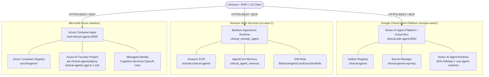
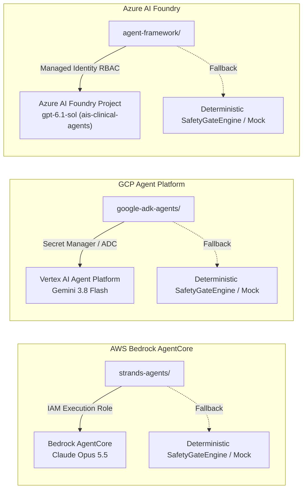

# Multi-Cloud Deployment Guide: Clinical Decision Support Agent Harness

*Unified multi-agent clinical decision support architecture deployed across Google Cloud (Agent Platform), Amazon Web Services (Bedrock AgentCore), and Microsoft Azure (AI Foundry + Container Apps).*

---

## 1. Executive Overview & Architecture

The **Laboratory Medicine Decision Support System** provides deterministic safety gating, LOINC ontology grounding, and multi-agent clinical synthesis.

All three cloud providers run production-grade continuous agent harnesses exposing FastAPI REST endpoints, FastMCP tools, and progressive disclosure token budgeting on port **8000**:



### Multi-Cloud Service Comparison

| Cloud Provider | Framework Deployed | Target Compute / Agent Service | Foundation Model Backend | Skill Store | Authentication & Secrets | Target Port | Health Check |
| :--- | :--- | :--- | :--- | :--- | :--- | :--- | :--- |
| **Google Cloud** | **`google-adk-agents/`** (Google ADK 2.0) | **Google Cloud Agent Platform** (Agent Runtime / Cloud Run) | Gemini 3.8 Flash (`gemini-3.8-flash`) | Cloud Storage, content-addressed (`gs://<project>-skills/skills`) | Secret Manager (`GEMINI_API_KEY`) + `roles/aiplatform.user` | 8000 | `/healthz`, `/readyz` |
| **AWS** | **`strands-agents/`** (AWS Strands SDK) | **Amazon Bedrock AgentCore Runtime** (Gateway, Memory, ECS Fargate) | Claude Opus 5.5 (`global.anthropic.claude-opus-5-5`) | S3, content-addressed (`s3://<project>-<env>-skills/skills`) | IAM Role (`BedrockAgentCoreExecutionRole`) | 8000 | `/healthz`, `/readyz` |
| **Microsoft Azure** | **`agent-framework/`** (Microsoft Agent Framework) | **Azure Container Apps** (ACA / Foundry Agent Service) | Azure AI Foundry / Azure OpenAI (`gpt-6.1-sol`) | Blob Storage, content-addressed (`azblob://<account>/skills/skills`) | System-Assigned Managed Identity (`Cognitive Services OpenAI User`) | 8000 | `/healthz`, `/readyz` |

---

## 2. Cloud AI Model Services Setup

Each framework connects to its native cloud LLM provider, with automated IAM roles, environment secrets, and deterministic offline safety fallback:



### 1. Amazon Bedrock AgentCore Setup (AWS)
- **Model Used**: Anthropic Claude Opus 5.5 (`global.anthropic.claude-opus-5-5`).
- **Target Region**: `us-east-1` (recommended for Bedrock AgentCore features and Claude availability).
- **Setup in AWS**:
  1. Ensure model access is enabled at [Bedrock Model Access](https://console.aws.amazon.com/bedrock/home?region=us-east-1#/modelaccess).
  2. The deployment script (`deploy.ps1` / `deploy.sh`) automatically provisions:
     - IAM Role `BedrockAgentCoreExecutionRole` with access to `bedrock-agentcore:*`, `bedrock-agent-runtime:*`, ECR, and CloudWatch Logs.
     - AgentCore Memory (`clinical_agent_memory`, events expire after 30 days) for session persistence.
     - Bedrock AgentCore Runtime (`clinical_strands_agent`). App Runner is used only with `APP_RUNNER_FALLBACK=true` (`-AppRunnerFallback`), because it bills for provisioned instances around the clock.
     - AgentCore Gateway endpoint for API routing and observability.
- **Offline / CI Mode**: If model access is not yet activated, `strands-agents` safely falls back to the deterministic pure-code `SafetyGateEngine` and `MockBedrockModel`.

### 2. Google Cloud Agent Platform Setup (GCP)
- **Model Used**: Gemini 3.8 Flash (`gemini-3.8-flash`) via Google ADK 2.0.
- **Target Region**: `europe-west1` (or `us-central1`).
- **Setup in GCP**:
  1. The deployment script enables `aiplatform.googleapis.com`, `discoveryengine.googleapis.com`, `dialogflow.googleapis.com`, `run.googleapis.com`, and `artifactregistry.googleapis.com`.
  2. Provisions Secret Manager secret `clinical-gemini-api-key` and grants both `roles/secretmanager.secretAccessor` and `roles/aiplatform.user` to the compute service account.
  3. Builds the knowledge release (`ontogate build`), publishes the locked skills, optionally deploys the ADK workflow to Vertex AI Agent Runtime as an `AdkApp` (`--use-agent-runtime`), and deploys the Cloud Run service (`clinical-adk-agent`) with Agent Platform runtime flags (`AGENT_PLATFORM_ENABLED=true`, `VERTEX_AI_PROJECT`, `GEMINI_MODEL`).
  4. Registers the agent with Vertex AI Agent Builder.
- **Offline / CI Mode**: When `GEMINI_API_KEY` is omitted, the service boots with `offline_mode: true` (alerted in `/readyz` as `status: degraded`) and deterministically enforces all 6 safety gap detectors.

### 3. Azure AI Foundry & Microsoft Agent Framework Setup (Azure)
- **Model Used**: `gpt-6.1-sol` via Microsoft Agent Framework (`agent-framework`).
- **Target Region**: `eastus` / `eastus2`.
- **Setup in Azure**:
  1. The deployment script automatically discovers or provisions an Azure AI Services account (`kind: AIServices`) and an Azure AI Foundry Project (`az cognitiveservices account project create`).
  2. Connects to the project endpoint (e.g. `https://<account>.services.ai.azure.com/api/projects/<project>`).
  3. Deploys the Container App (`maf-clinical-agents`) with a **System-Assigned Managed Identity**.
  4. Automatically assigns the keyless RBAC role **`Cognitive Services OpenAI User`** to the container's identity, eliminating raw API keys.
  5. The runtime utilizes `DefaultAzureCredential()` in `agent-framework/src/models/provider.py` for keyless authentication.
- **Offline / CI Mode**: If endpoints are omitted, `agent-framework` activates `MAF_OFFLINE_MODE=true` and runs the deterministic safety workflow offline.

---

## 3. Prerequisites & Verification

All three CLI tools (`gcloud`, `aws`, `az`), `docker`, and Git Bash for Windows should be installed and authenticated on your local workstation.

Verify authentication before proceeding:

```bash
# Google Cloud
gcloud auth list
gcloud config get-value project

# AWS
aws sts get-caller-identity

# Azure
az account show --output table

# Docker Daemon
docker version
```

In PowerShell:
```powershell
gcloud auth list
aws sts get-caller-identity
az account show --output table
docker version
```

---

## 4. Amazon Web Services (AWS) Deployment (`deployment/aws-scripts/`)

Deploys the AWS Strands Agents SDK solution (`strands-agents/`) to **Amazon Bedrock AgentCore Runtime** with **Amazon ECR** and **AgentCore Memory**.

### Quickstart (1 Command)

**Bash / Git Bash:**
```bash
cd deployment/aws-scripts
chmod +x *.sh
./deploy.sh
```

**PowerShell:**
```powershell
cd deployment\aws-scripts
.\deploy.ps1 -AwsRegion us-east-1
```

### Script Parameters & Configuration (`deployment/aws-scripts/config.env`)

```ini
AWS_REGION="us-east-1"
AGENT_NAME="clinical_strands_agent"     # AgentCore names: [a-zA-Z][a-zA-Z0-9_]{0,47}
ECR_REPO_NAME="strands-clinical-agents"
IMAGE_TAG="latest"
BEDROCK_MODEL_ID="global.anthropic.claude-opus-5-5"
AGENT_ROLE_NAME="BedrockAgentCoreExecutionRole"
MEMORY_NAME="clinical_agent_memory"
MEMORY_EXPIRY_DAYS=30
APP_RUNNER_FALLBACK=false               # true: deploy to App Runner if AgentCore fails (always-on billing)
PORT=8000
```

### Manual Deployment Walkthrough with `aws` CLI

```bash
# 1. Variables
AWS_REGION="us-east-1"
ACCOUNT_ID="$(aws sts get-caller-identity --query Account --output text)"
ECR_REPO="strands-clinical-agents"
AGENT_NAME="clinical_strands_agent"
ECR_URI="${ACCOUNT_ID}.dkr.ecr.${AWS_REGION}.amazonaws.com/${ECR_REPO}"

# 2. Create Amazon ECR Repository
aws ecr create-repository \
  --repository-name "${ECR_REPO}" \
  --region "${AWS_REGION}" \
  --image-scanning-configuration scanOnPush=true

# 3. Build & push Docker image from strands-agents/Dockerfile
cd ../..
aws ecr get-login-password --region "${AWS_REGION}" | docker login --username AWS --password-stdin "${ECR_URI}"
docker build -f strands-agents/Dockerfile -t "${ECR_URI}:latest" .
docker push "${ECR_URI}:latest"

# 4. Create Bedrock AgentCore IAM Execution Role
aws iam create-role \
  --role-name BedrockAgentCoreExecutionRole \
  --assume-role-policy-document '{"Version":"2012-10-17","Statement":[{"Effect":"Allow","Principal":{"Service":"bedrock-agentcore.amazonaws.com"},"Action":"sts:AssumeRole"}]}'

# Least privilege: deploy.sh writes the full scoped policy (model invoke, this ECR repo,
# /aws/bedrock-agentcore/* logs, X-Ray, this account's AgentCore memories).
aws iam put-role-policy \
  --role-name BedrockAgentCoreExecutionRole \
  --policy-name ClinicalAgentRuntimeAccess \
  --policy-document file://clinical-agent-runtime-policy.json

ROLE_ARN="$(aws iam get-role --role-name BedrockAgentCoreExecutionRole --query Role.Arn --output text)"

# 5. Provision AgentCore Memory (control plane: bedrock-agentcore-control)
aws bedrock-agentcore-control create-memory \
  --name clinical_agent_memory --event-expiry-duration 30 \
  --memory-execution-role-arn "${ROLE_ARN}" --region "${AWS_REGION}"

# 6. Create the AgentCore Runtime
aws bedrock-agentcore-control create-agent-runtime \
  --agent-runtime-name "${AGENT_NAME}" \
  --agent-runtime-artifact "{\"containerConfiguration\":{\"containerUri\":\"${ECR_URI}:latest\"}}" \
  --role-arn "${ROLE_ARN}" --network-configuration '{"networkMode":"PUBLIC"}' \
  --region "${AWS_REGION}"

# Resources created by hand are not in the teardown ledger: delete them yourself, or
# run ./destroy.sh --discover to find the default-named ones.
```

### Verification & Testing
```bash
./test-service.sh
# or in PowerShell:
.\test-service.ps1
```

### Teardown
```bash
./destroy.sh              # plan: lists exactly what deploy.sh created, newest first
./destroy.sh --yes        # delete it
# or in PowerShell:
.\destroy.ps1            # plan
.\destroy.ps1 -Yes       # delete
```

---

## 5. Google Cloud Deployment (`deployment/gcloud-scripts/`)

Deploys the Google ADK continuous clinical agent harness (`google-adk-agents/`) to **Google Cloud Agent Platform** (Vertex AI Agent Runtime / Cloud Run) using **Artifact Registry** and **Secret Manager**.

### Quickstart (1 Command)

**Bash / Git Bash:**
```bash
cd deployment/gcloud-scripts
chmod +x *.sh
./deploy.sh
```

**PowerShell:**
```powershell
cd deployment\gcloud-scripts
.\deploy.ps1 -ProjectId openagi-codes -Region europe-west1
```

### Script Parameters & Configuration (`deployment/gcloud-scripts/config.env`)

```ini
PROJECT_ID="openagi-codes"
REGION="europe-west1"
AGENT_RESOURCE_NAME="clinical-adk-agent"
REPO_NAME="clinical-agents"
IMAGE_NAME="clinical-adk-harness"
MODEL_ID="gemini-3.8-flash"
PORT=8000
CPU="1"
MEMORY="2Gi"
MIN_INSTANCES=0
MAX_INSTANCES=10
```

### Manual Deployment Walkthrough with `gcloud`

```bash
# 1. Variables
PROJECT_ID="$(gcloud config get-value project)"
REGION="europe-west1"
REPO_NAME="clinical-agents"
IMAGE_NAME="clinical-adk-harness"
SERVICE_NAME="clinical-adk-agent"
IMAGE_URI="${REGION}-docker.pkg.dev/${PROJECT_ID}/${REPO_NAME}/${IMAGE_NAME}:latest"

# 2. Enable Agent Platform APIs
gcloud services enable \
  aiplatform.googleapis.com \
  artifactregistry.googleapis.com \
  secretmanager.googleapis.com \
  cloudbuild.googleapis.com \
  run.googleapis.com \
  discoveryengine.googleapis.com \
  dialogflow.googleapis.com \
  --project="${PROJECT_ID}"

# 3. Create Artifact Registry Docker repository
gcloud artifacts repositories create "${REPO_NAME}" \
  --repository-format=docker \
  --location="${REGION}" \
  --description="Clinical Agent Platform containers" \
  --project="${PROJECT_ID}"

# 4. Build and push container image
cd ../..
gcloud auth configure-docker "${REGION}-docker.pkg.dev" --quiet
docker build -f google-adk-agents/Dockerfile -t "${IMAGE_URI}" .
docker push "${IMAGE_URI}"

# 5. Store GEMINI_API_KEY and grant Vertex AI permissions
gcloud secrets create clinical-gemini-api-key --replication-policy="automatic" --project="${PROJECT_ID}"
echo -n "${GEMINI_API_KEY}" | gcloud secrets versions add clinical-gemini-api-key --data-file=- --project="${PROJECT_ID}"

PROJECT_NUM="$(gcloud projects describe ${PROJECT_ID} --format='value(projectNumber)')"
gcloud secrets add-iam-policy-binding clinical-gemini-api-key \
  --member="serviceAccount:${PROJECT_NUM}-compute@developer.gserviceaccount.com" \
  --role="roles/secretmanager.secretAccessor" \
  --project="${PROJECT_ID}"

gcloud projects add-iam-policy-binding "${PROJECT_ID}" \
  --member="serviceAccount:${PROJECT_NUM}-compute@developer.gserviceaccount.com" \
  --role="roles/aiplatform.user"

# 6. Deploy to Cloud Run with Agent Platform environment
gcloud run deploy "${SERVICE_NAME}" \
  --image="${IMAGE_URI}" \
  --platform=managed \
  --region="${REGION}" \
  --port=8000 \
  --cpu=1 \
  --memory=2Gi \
  --min-instances=0 \
  --max-instances=10 \
  --set-env-vars="ALLOWED_ORIGINS=*,MAX_SESSIONS=1000,VERTEX_AI_PROJECT=${PROJECT_ID},VERTEX_AI_LOCATION=${REGION},GEMINI_MODEL=gemini-3.8-flash,AGENT_PLATFORM_ENABLED=true" \
  --set-secrets="GEMINI_API_KEY=clinical-gemini-api-key:latest" \
  --allow-unauthenticated \
  --project="${PROJECT_ID}"
```

### Verification & Testing
```bash
./test-service.sh
# or in PowerShell:
.\test-service.ps1
```

### Teardown
```bash
./destroy.sh              # plan: lists exactly what deploy.sh created, newest first
./destroy.sh --yes        # delete it
# or in PowerShell:
.\destroy.ps1            # plan
.\destroy.ps1 -Yes       # delete
```

---

## 6. Microsoft Azure Deployment (`deployment/az-scripts/`)

Deploys the Microsoft Agent Framework solution (`agent-framework/`) to **Azure Container Apps (ACA)** wired with **Azure AI Foundry** and **Managed Identity RBAC**.

### Quickstart (1 Command)

**Bash / Git Bash:**
```bash
cd deployment/az-scripts
chmod +x *.sh
./deploy.sh
```

**PowerShell:**
```powershell
cd deployment\az-scripts
.\deploy.ps1 -ResourceGroup rg-clinical-agents -Location eastus
```

### Script Parameters & Configuration (`deployment/az-scripts/config.env`)

```ini
RESOURCE_GROUP="rg-clinical-agents"
LOCATION="eastus"
ENVIRONMENT_NAME="cae-clinical-agents"
APP_NAME="maf-clinical-agents"
IMAGE_NAME="agent-framework"
IMAGE_TAG="latest"
PORT=8000
CPU="1.0"
MEMORY="2.0Gi"
MIN_REPLICAS=0
MAX_REPLICAS=5

# Azure AI Foundry Configuration (Azure CAF Standard: ais-*, aiproj-*)
AI_FOUNDRY_ACCOUNT_NAME="ais-clinical-agents"
AI_FOUNDRY_PROJECT_NAME="aiproj-clinical-agents"
AI_FOUNDRY_RESOURCE_GROUP="rg-clinical-agents"
FOUNDRY_MODEL="gpt-6.1-sol"
```

### Manual Deployment Walkthrough with `az` CLI

```bash
# 1. Variables
RESOURCE_GROUP="rg-clinical-agents"
LOCATION="eastus"
ACR_NAME="acrclinagents$(date +%s | cut -c5-10)"
ENVIRONMENT_NAME="cae-clinical-agents"
APP_NAME="maf-clinical-agents"
AI_ACCOUNT="ais-clinical-agents"
AI_PROJECT="aiproj-clinical-agents"
TARGET_AI_RG="rg-clinical-agents"

# 2. Create Resource Group & ACR
az group create --name "${RESOURCE_GROUP}" --location "${LOCATION}"
az acr create --resource-group "${RESOURCE_GROUP}" --name "${ACR_NAME}" --sku Basic --admin-enabled true

ACR_LOGIN_SERVER="$(az acr show --name ${ACR_NAME} --query loginServer -o tsv)"
ACR_USER="$(az acr credential show --name ${ACR_NAME} --query username -o tsv)"
ACR_PASS="$(az acr credential show --name ${ACR_NAME} --query passwords[0].value -o tsv)"

# 3. Build container using Azure ACR Tasks from agent-framework/Dockerfile
cd ../..
az acr build \
  --registry "${ACR_NAME}" \
  --image "agent-framework:latest" \
  --file "agent-framework/Dockerfile" \
  .

# 4. Query AI Foundry Project Endpoint
FOUNDRY_ENDPOINT="$(az cognitiveservices account project show --name ${AI_ACCOUNT} --resource-group ${TARGET_AI_RG} --project-name ${AI_PROJECT} --query 'properties.endpoints."AI Foundry API"' -o tsv)"
AI_ACCOUNT_ID="$(az cognitiveservices account show --name ${AI_ACCOUNT} --resource-group ${TARGET_AI_RG} --query id -o tsv)"

# 5. Create Azure Container Apps Environment
az containerapp env create \
  --name "${ENVIRONMENT_NAME}" \
  --resource-group "${RESOURCE_GROUP}" \
  --location "${LOCATION}"

# 6. Deploy Azure Container App with System-Assigned Managed Identity
az containerapp create \
  --name "${APP_NAME}" \
  --resource-group "${RESOURCE_GROUP}" \
  --environment "${ENVIRONMENT_NAME}" \
  --image "${ACR_LOGIN_SERVER}/agent-framework:latest" \
  --target-port 8000 \
  --ingress external \
  --registry-server "${ACR_LOGIN_SERVER}" \
  --registry-username "${ACR_USER}" \
  --registry-password "${ACR_PASS}" \
  --system-assigned \
  --cpu 1.0 \
  --memory 2.0Gi \
  --min-replicas 0 \
  --max-replicas 5 \
  --env-vars ALLOWED_ORIGINS=* MAX_SESSIONS=1000 AZURE_AI_FOUNDRY_PROJECT_ENDPOINT="${FOUNDRY_ENDPOINT}" FOUNDRY_MODEL="gpt-6.1-sol"

# 7. Grant Container App Managed Identity access to Azure AI Foundry
APP_PRINCIPAL_ID="$(az containerapp show --name ${APP_NAME} --resource-group ${RESOURCE_GROUP} --query identity.principalId -o tsv)"
az role assignment create \
  --assignee-object-id "${APP_PRINCIPAL_ID}" \
  --assignee-principal-type "ServicePrincipal" \
  --role "Cognitive Services OpenAI User" \
  --scope "${AI_ACCOUNT_ID}"
```

### Verification & Testing
```bash
./test-service.sh
# or in PowerShell:
.\test-service.ps1
```

### Teardown
```bash
./destroy.sh              # plan: lists exactly what deploy.sh created, newest first
./destroy.sh --yes        # delete it
# or in PowerShell:
.\destroy.ps1            # plan
.\destroy.ps1 -Yes       # delete
```

---

## 7. REST API Reference & Endpoints

All deployed instances expose the following REST API endpoints:

| Method | Endpoint | Description |
| :--- | :--- | :--- |
| `GET` | `/healthz` | Liveness probe (HTTP 200 `{"status": "healthy"}`) |
| `GET` | `/readyz` | Readiness probe and registered MCP tools discovery |
| `POST` | `/api/v1/sessions` | Initializes a new isolated clinician conversation session |
| `GET` | `/api/v1/sessions/{id}` | Retrieves turn history and state for an active session |
| `POST` | `/api/v1/query` | Submits an order/query through deterministic safety gating and synthesis |

### Sample Request: Ambiguity Resolution (`Hb 13.5 | g/dL`)

```bash
curl -X POST "https://<YOUR_DEPLOYED_SERVICE_URL>/api/v1/query" \
  -H "Content-Type: application/json" \
  -d '{
    "prompt": "Hb 13.5 | g/dL",
    "user_id": "dr_clinician"
  }'
```

### Sample Response: Grounded & Attested Interpretation
```json
{
  "session_id": "4a7f0529-57e1-4560-951b-c744230b5b18",
  "text": "[Attested ✓] Hemoglobin 13.5 g/dL (LOINC 718-7) is within adult reference interval (13.8 - 17.2 g/dL). No panic limits breached.",
  "route": "PROCEED",
  "status": "RESOLVED",
  "attested": true,
  "is_hitl_paused": false,
  "tool_calls_count": 3,
  "clarification": null
}
```

---

## 8. Security & Clinical Guardrail Best Practices

1. **Deterministic Safety Gating (Fail-Closed)**:
   The `SafetyGateEngine` executes without LLM calls. The route strictly maps `RESOLVED -> PROCEED`; all other statuses (`AMBIGUOUS`, `UNIT_MISMATCH`, `NOT_FOUND`, `RANGE_COLLISION`, `UNKNOWN`) fail closed to `CLARIFY`.
2. **Keyless Zero-Trust IAM Privileges**:
   - **Google Cloud**: Service account binds `roles/secretmanager.secretAccessor` and `roles/aiplatform.user`.
   - **AWS**: Bedrock AgentCore execution role binds scoped `bedrock-agentcore:*` and `bedrock-agent-runtime:*` policies.
     The `secretsmanager:GetSecretValue` action is scoped to
     `arn:…:secret:${ProjectName}/${Environment}/*-*` by default.
     Override with the `SecretNamePrefix` CloudFormation parameter when your secrets
     live under a custom path (e.g. `myteam/clinical`). **Never deploy with `Resource: "*"`
     for Secrets Manager.**
   - **Azure**: System-Assigned Managed Identity binds the `Cognitive Services OpenAI User` RBAC role directly to the Azure AI Services resource for keyless `DefaultAzureCredential()` calls.
3. **Session Fixation Prevention**:
   All session IDs are server-issued UUIDs. Client-supplied IDs in `POST /api/v1/query` are ignored for new sessions.
4. **Memory Management**:
   The session cap (`MAX_SESSIONS`, default `1000`) and prompt length cap (`MAX_PROMPT_LENGTH`, default `2000`) prevent unbounded memory growth in production containers.
5. **No Secrets in Source Control**:
   All `.env` files are listed in `.gitignore`. Credentials are injected at runtime via
   AWS Secrets Manager, Google Cloud Secret Manager, or Azure Key Vault references —
   never committed to the repository.

---

## 9. Cleanup & Cost Control

Every deploy script appends each resource it **creates** to
`deployment/<cloud>-scripts/.deployed/ledger.tsv` (git-ignored). `destroy.sh` /
`destroy.ps1` run [`deployment/teardown.py`](teardown.py), which deletes exactly those
resources, newest first, so dependents go before what they depend on. Resources a deploy
only reused, such as a Foundry account or bucket you already had, are never recorded and
never deleted.

- **Plan first.** Without `--yes` / `-Yes` the scripts only print the plan.
- **Failures are kept.** A resource that fails to delete stays in the ledger; re-run to retry.
- **No ledger** (a deploy made before ledgers existed, or by hand): `--discover` finds the
  default-named resources. On Azure it never deletes the resource group or a Foundry account
  unless you pass `--delete-resource-group <name>`, because either may hold other work.
- **IAM grants** (GCP project-level `roles/aiplatform.user`) are listed for review and removed
  only with `--include-iam`. They cost nothing and may pre-date the deploy.

| Cloud | Created by deploy → deleted by teardown | Bills while idle? | Not deployment-owned — check yourself |
| :--- | :--- | :--- | :--- |
| **GCP** | Cloud Run service, Agent Runtime (`--use-agent-runtime`), Artifact Registry repository, Secret Manager secret | Cloud Run scales to zero; Agent Runtime and image storage bill while present | Cloud Build bucket `gs://<project>_cloudbuild`, Agent Runtime staging bucket, skill-store bucket |
| **AWS** | AgentCore runtime (+ its `/aws/bedrock-agentcore/runtimes/<id>*` log groups), AgentCore memory, App Runner service (opt-in fallback), ECR repository, IAM role and its inline policies | App Runner bills for provisioned instances around the clock; ECR and log storage bill while present | S3 skill-store bucket, a hand-deployed `agentcore-platform.yaml` stack (`aws cloudformation delete-stack`) |
| **Azure** | Container App, its role assignment, Container Apps environment and the Log Analytics workspace it created, ACR, and — only when the deploy created them — the Foundry model deployment, project and account (account purged after delete), resource group | ACR (Basic) bills daily; Log Analytics bills for ingestion; Container Apps scale to zero | Skill-store storage account; a Foundry account you already had |

After a demo, run the teardown for every cloud you deployed to:

```bash
deployment/gcloud-scripts/destroy.sh --yes
deployment/aws-scripts/destroy.sh --yes
deployment/az-scripts/destroy.sh --yes
```
