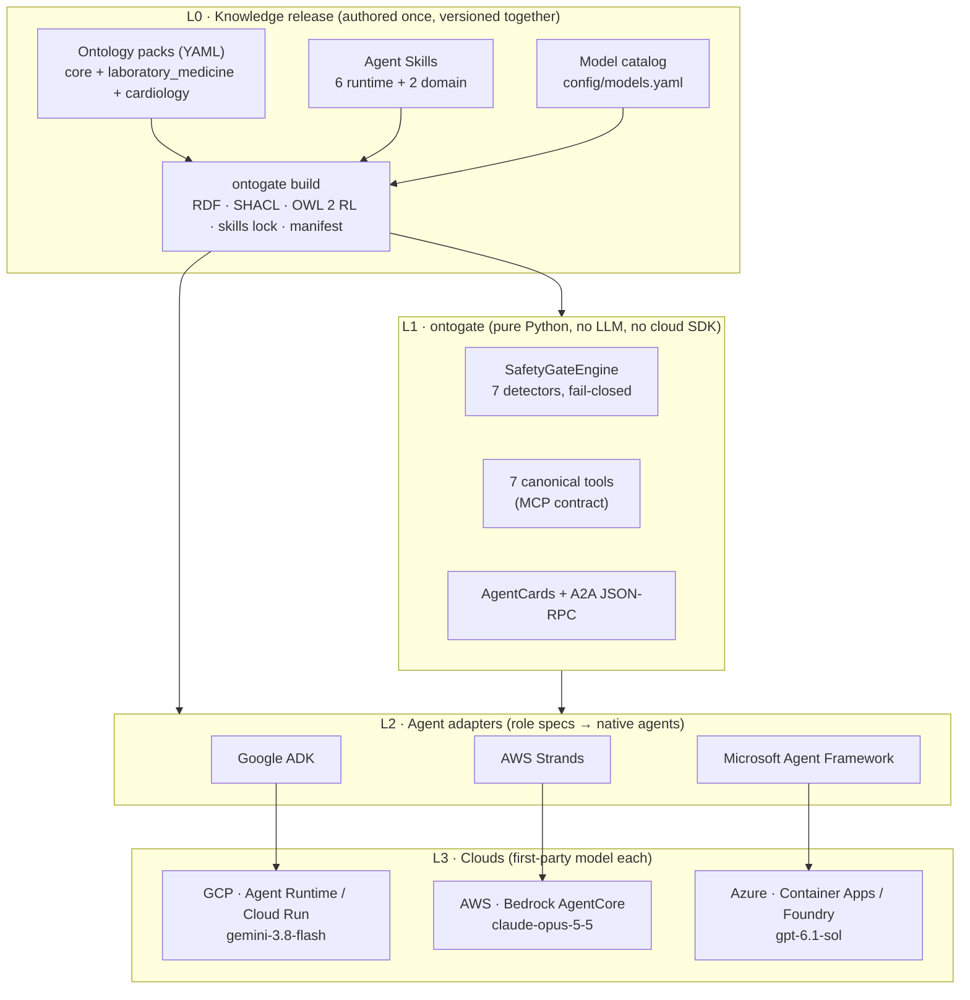

# When the Retriever Has to Decide: Ontology-Governed Deterministic Gating for Portable Multi-Agent Clinical Decision Support

**Dr. Amit Puri** · October 2026 · Technical report on the state of the `multiagent-retrieval-gaps` repository as of 2026-10-11

---

## Abstract

Retrieval-augmented agents inherit every failure mode of classical retrieval, and they add new ones: they guess instead of asking, they enforce safety rules through prompts, their trajectories are rarely evaluated, and they trust tool output without scoping it. In laboratory medicine these failures are concrete and dangerous. "Hb 13.5" may be a borderline-normal haemoglobin or a severe HbA1c. "Calcium 4.8 mg/dL" is critically low as total calcium and normal as ionised calcium.

We present an architecture that splits the knowledge an agent needs into three kinds, each with one home:
- **declarative** knowledge (what a term means) lives in a versioned ontology compiled to SKOS, OWL 2, SHACL and PROV-O;
- **normative** knowledge (whether the system may proceed) lives in a deterministic, fail-closed gate written as code;
- **procedural** knowledge (how each agent role behaves) lives in role-scoped Agent Skills.

The gate is a framework-agnostic Python package, `ontogate`, with seven pluggable hazard detectors. Only a `RESOLVED` decision proceeds to model synthesis; everything else routes to clarification.

The ontology is *functional*, not descriptive. Every TBox construct has one runtime role:
- designations produce candidate sets;
- facets produce the clarifying question;
- `confusableWith` declares look-alike families;
- structured intervals and molar masses drive deterministic attestation;
- `precedes` governs specimen order.

We describe the full ontology-engineering lifecycle as practised, from competency questions to a hashed release, and trace real inputs to the ontology constructs that decided them.

The same knowledge release drives three agent frameworks on three clouds:
- Google ADK with Gemini 3.8 Flash on Google Cloud;
- AWS Strands Agents with Claude Opus 5.5 on Bedrock AgentCore;
- Microsoft Agent Framework with GPT-6.1 Sol on Azure AI Foundry.

We evaluate with 35 executable competency questions across two domain packs, a cross-framework conformance runner, a live-endpoint runner, deterministic answer graders and 620 offline tests.

Results:
- All 35 competency questions meet their expected decisions.
- The three frameworks reproduce the canonical gate decision on every case, with zero divergences.
- A second clinical domain (cardiology) was added without changing gate code or role specifications.
- Statement coverage is 70.8% over 6,710 statements: 87.7% for the shared core and 93.9% for the gate-critical modules.

All results are offline. Live-model evaluations, skill ablation and managed-runtime deployments remain open.

**Keywords:** retrieval gaps, multi-agent systems, deterministic safety gate, ontology engineering, SKOS, SHACL, Agent Skills, MCP, A2A, clinical decision support, cross-cloud conformance

---

## 1. Introduction

An agent is a retriever that has to decide. Earlier parts of this series catalogued seven retrieval gaps in classical and RAG pipelines ([Part I](https://www.linkedin.com/pulse/information-retrieval-dr-amit-puri-ahcec/), [Part II](https://www.linkedin.com/pulse/information-retrieval-when-similarity-isnt-enough-dr-amit-puri-2rnzc/), [Recap](https://www.linkedin.com/pulse/recap-where-retrieval-gaps-diagnose-fix-dr-amit-puri-fhlwf)). When retrieval output feeds an autonomous decision instead of a human reader, four further gaps appear:

| Gap | Failure mode | Consequence in laboratory medicine |
| :--- | :--- | :--- |
| **8** Ambiguity & silent guessing | The agent picks one reading of an ambiguous term | "Hb 13.5" read as haemoglobin when HbA1c was meant |
| **9** Safety rule in a prompt | A guardrail is probabilistic | A unit or range rule is followed most of the time |
| **10** Trajectory never evaluated | Only final answers are checked | A correct answer reached through an unsafe path passes review |
| **11** Tool output trusted, unscoped | Tool results are used outside their scope | A CSF specimen routed to the wrong department or tube |

Three retrieval-level gaps are also in scope: **Gap 2** (unit mismatch), **Gap 5** (missing qualifier) and **Gap 6** (missing unit). So are **look-alike range collisions**, where two assays share a label but classify the same value differently.

The central claim of this work is that *an ontology's job in an agent is to define what a term means, and when to stop*. The stopping decision must be deterministic, auditable and identical wherever the agent runs.

**Contributions.**

1. **A three-way separation of agent knowledge** — the ontology says *what*, the gate says *whether*, skills say *how*. Machine-checked rules enforce the separation: skills may not contain clinical numbers or routing; the gate never reads a skill; the ontology contains no prompt text.
2. **A fail-closed gate whose behaviour is derived from the ontology.** Seven detectors run in a fixed order. Their decisions come from typed relations (`denotes`, `confusableWith`, `differentiatedBy`, `hasInterval`, `precedes`) rather than analyte-specific code. We give a construct-to-function contract (Table 6) and worked traces (Table 7) showing which ontology elements decide each input.
3. **An executable ontology-engineering lifecycle.** Specification, conceptualization, formalization, integration, evaluation and maintenance each have an artifact and a check: behavioural and structural (SPARQL) competency questions, 26 integrity rules, SHACL shapes, build-time OWL 2 RL, and a hashed release. A clinical domain was added through this loop with data changes only.
4. **One knowledge release consumed by three frameworks on three clouds.** It contains the ontology bundle, the hash-locked skills and the model catalog. One canonical tool contract (seven MCP tools) and one A2A binding sit on top.
5. **An evaluation harness for cross-framework parity**: executable competency questions, a conformance runner, a live-endpoint runner and deterministic answer graders. The truth always comes from the canonical pipeline, never from another model.
6. **An empirical account of the repository's current state**: test outcomes, measured statement coverage and an explicit list of open items.

---

## 2. Background and Related Work

**Ontologies and terminologies.**
- Laboratory observables are identified by LOINC codes and their units by UCUM.
- The formal layer uses W3C standards: SKOS and SKOS-XL for vocabularies and designations, OWL 2 for relation characteristics, SHACL for integrity constraints, and PROV-O for provenance.
- Following ontology-engineering practice, *competency questions* (CQs) state what the ontology must be able to answer. Here they are executable test cases rather than prose.
- The companion document [`ontology-kg-okf-for-ai-agents.md`](ontology-kg-okf-for-ai-agents.md) describes the Open Knowledge Format (OKF) metadata used here: trust tiers, lifecycle, freshness and attestation.

**Agent interoperability.**
- The **Model Context Protocol (MCP)** standardises how agents call tools.
- The **Agent-to-Agent (A2A)** protocol standardises agent discovery (AgentCards) and messaging.
- **Agent Skills** (the `SKILL.md` format of agentskills.io) package procedural instructions with progressive disclosure: only a short description is resident, and the body loads on demand.
- All three frameworks studied here load Agent Skills natively: ADK `SkillToolset`, Strands `AgentSkills` and MAF `SkillsProvider`.

**Graph-enhanced retrieval.** GraphRAG ([Edge et al., 2024](https://arxiv.org/abs/2404.16130)) and LightRAG ([Guo et al., 2024](https://arxiv.org/abs/2410.05779)) use graph structure to improve recall and summarisation. Our use of a graph is different. Relations such as `confusableWith` and `precedes` are not retrieval aids; they are *hazard declarations* that the gate must act on before any generation happens.

**Typed decision models.** A new class of single-pass models scores fixed option sets rather than generating text ([`Decision-Models-Trend-Evidence-and-Outlook.md`](Decision-Models-Trend-Evidence-and-Outlook.md)). We place them as an optional middle tier between the deterministic gate and generative synthesis. Order-sensitivity results reported for some of these models reinforce our position: clinical safety rules must not be delegated to any model, typed or generative.

**Memory architectures.** The fourteen-part memory taxonomy in [`ai-agent-memory-architecture.md`](ai-agent-memory-architecture.md) informs the production design (§4.6). Procedural memory, in particular, is changed only through versioned skills and never learned from conversations.

---

## 3. Problem Formulation

A clinician query is parsed into a context

$$c = (t, v, u, q, p, k)$$

where:
- $t$ is a term (e.g. "Calcium");
- $v$ is an optional numeric value;
- $u$ is an optional unit;
- $q$ is an optional qualifier (a facet value such as *total* or *ionized*);
- $p$ is an optional population context (sex, age band);
- $k$ is an optional panel or department scope.

The gate is a total function

$$G(c) \rightarrow (s, r, \text{evidence}), \quad s \in \mathcal{S}, \quad r \in \{\text{PROCEED}, \text{CLARIFY}\}$$

with status set

$$\mathcal{S} = \{\text{RESOLVED}, \text{AMBIGUOUS}, \text{UNIT}\_\text{MISMATCH}, \text{RANGE}\_\text{COLLISION}, \text{MISSING}\_\text{QUALIFIER}, \text{SCOPE}\_\text{VIOLATION}, \text{NOT}\_\text{FOUND}, \text{MODEL}\_\text{UNAVAILABLE}, \text{UNKNOWN}\}$$

and the single routing invariant

$$r = \text{PROCEED} \iff s = \text{RESOLVED}.$$

Every other status, including a detector raising an exception (mapped to `UNKNOWN`) and a model refusal or truncation (mapped to `MODEL_UNAVAILABLE`), routes to `CLARIFY`. The evidence carries what the clarification needs: candidate concepts, the differentiating facet and its allowed values, candidate units, and per-candidate readings.

Let $D(t) = \{o \mid t \text{ denotes } o\}$ be the observables a designation denotes. The gate's decisions are derived from the ontology as follows:

| Decision | Derivation |
| :--- | :--- |
| Candidates | $D(t)$, excluding deprecated observables |
| Unit filter | UCUM-normalised $u \in o.\text{units}$; no candidate survives → `UNIT_MISMATCH` |
| Qualifier narrowing | $q$ is mapped through facet value synonyms; a contradiction with the resolved facet value is reported |
| Missing qualifier | $\lvert D(t)\rvert > 1$ and the candidates differ on a facet → ask for that facet |
| Range collision | $\lvert D(t)\rvert > 1$, $v$ present, and per-interval classifications diverge → `RANGE_COLLISION` with readings |
| Population context | Intervals differ by sex or age and $p$ is missing → clarify, per `gate_policy` |
| Panel scope | `precedes`-ordered collection steps filtered by department |

---

## 4. System Architecture

### 4.1 Layers



*Figure 1. Layered architecture. Each layer depends only on the layers above it. The gate (L1) never depends on a model, a framework or a cloud.*

### 4.2 Separation of knowledge

| Kind | Question | Home | Enforced by |
| :--- | :--- | :--- | :--- |
| Declarative | *What* does a term mean? | Ontology packs → SKOS/OWL/PROV-O bundle | Integrity validator, SHACL shapes, CQs |
| Normative | *Whether* to proceed | `ontogate.detectors` (code) | Gate invariants, `test_gate.py`, conformance |
| Procedural | *How* a role behaves | `skills/runtime/*/SKILL.md` | Clinical lint (no numbers, no routing, no scripts), `RoleSkillShape` |

Skill *references* (designation indexes, facet questions, trust caveats, panel orders) are **rendered from the ontology** at build time. `ontogate skills check` fails if a rendered reference differs from the ontology, so skills cannot drift from the facts they describe.

### 4.3 The gate

`SafetyGateEngine` runs its detectors in a fixed order and stops at the first one that does not resolve:

| # | Detector | Hazard | Gap |
| :--- | :--- | :--- | :--- |
| 1 | `UnitMismatchDetector` | Unit valid for no candidate | 2 |
| 2 | `RangeCollisionDetector` | Look-alikes classify the value differently | look-alike |
| 3 | `MissingQualifierDetector` | Candidates differ on a facet, and no qualifier is given | 5 |
| 4 | `AmbiguityDetector` | Several candidates remain | 8 |
| 5 | `MissingUnitDetector` | Numeric value supplied without a unit | 6 |
| 6 | `PopulationContextDetector` | A critical classification depends on sex or age, and the context is missing | — |
| 7 | `SpecimenSequenceDetector` | Panel tube order or department scope violated | 11 |

The order is itself a finding. The ontology review found that four of the original calcium competency questions failed (plan §4, A1). One cause was that a generic ambiguity check ran first, which made range collision unreachable. Placing the look-alike checks before the generic ambiguity check means the most informative clarification wins: the clinician learns *why* the value is dangerous, not only that the term is ambiguous.

**Fail-closed properties** (all tested):
- An empty detector list raises at construction, because it would otherwise resolve every input.
- A detector exception becomes `UNKNOWN` → `CLARIFY`.
- A third-party detector plugin that fails to load is skipped, and the built-in suite still runs.
- The success result is built from the context and the passing detectors' readings, never from a detector's candidate list. This prevents candidate leakage.
- A bundle or skill hash mismatch refuses startup.

New hazard classes are added as entry-point plugins (`ontogate.detectors`). That is the only extension in Table 3 that needs code.

### 4.4 Roles, tools and skills

Seven role specifications (`agents/*.yaml`) declare each role's tools, skills, model tier and short base instruction. They are the only source for agent construction in all three frameworks; MAF's declarative YAML is generated from them and drift-checked.

| Role | Model | Tools granted | Runtime skill |
| :--- | :--- | :--- | :--- |
| `triage_orchestrator` | reasoning | `parse_clinician_input`, `resolve_lab_term`, `evaluate_safety_gate` | `clinical-triage` |
| `ontology_resolver` | flash | `resolve_lab_term` | `lab-term-resolution` (+ domain skill) |
| `safety_guard` | **none (code node)** | `evaluate_safety_gate` | **none** |
| `protocol_retriever` | flash | `fetch_grounded_protocol` | `protocol-retrieval` |
| `clinical_synthesizer` | reasoning | `fetch_grounded_protocol`, `attest_computation` | `grounded-synthesis` (+ domain skill) |
| `clarification_coordinator` | flash | `build_clarification_prompt` | `clarification-dialogue` |
| `panel_coordinator` | flash | `panel_workup` | `specimen-sequencing` |

*Table 1. Role specifications. The triage orchestrator delegates to the protocol retriever, synthesiser, clarification coordinator and panel coordinator.*

The **canonical tool contract** has seven MCP tools, served by one FastMCP server (`ontogate.mcp_server`):
- `parse_clinician_input`
- `resolve_lab_term`
- `evaluate_safety_gate`
- `fetch_grounded_protocol`
- `attest_computation`
- `build_clarification_prompt`
- `panel_workup`

Every tool returns a dict with a `status`. Before this contract existed, the same capability had up to two names across frameworks (plan finding H1).

Each framework binds the tools **in-process**, and each role agent receives exactly the tools its specification grants. We evaluated managed cloud tool gateways and the open-source agentgateway, and did not adopt them (plan §9.5). No caller reaches the tools over the network, so a gateway would guard an unused door. Role-level authorisation would also require each role to run as a separate workload with its own identity. We defined an adoption trigger instead: serving the MCP server to callers outside the agent process.

**Attestation.** Numeric interpretation against reference intervals is computed deterministically by `attest_computation`. The `[Attested ✓]` badge may appear in an answer only if attestation passed, and the answer graders enforce this (§6.3).

### 4.5 Knowledge release

`ontogate build` produces a release with three integrity-checked parts:
- **the ontology bundle:** `bundle.json`, Turtle, JSON-LD and RDF/XML;
- **the skills bundle:** content-addressed archives with `skills.lock.json`;
- **the model catalog snapshot.**

A manifest records a SHA-256 hash for each. Runtimes verify the bundle and skill hashes at startup and fail closed.

Skills can be published to content-addressed cloud stores (`gs://`, `s3://`, `azblob://`). A runtime that sets `ONTOGATE_SKILL_STORE` materialises and hash-verifies them instead of using the copies baked into the image. Reasoning (OWL 2 RL materialisation of symmetric and inverse relations) happens only at build time; request-time reasoning is out of scope.

### 4.6 Multi-framework, multicloud realisation

| | Google Cloud | AWS | Microsoft Azure |
| :--- | :--- | :--- | :--- |
| Framework | Google ADK ≥ 2.11 | Strands Agents SDK | Microsoft Agent Framework |
| Model (catalog-pinned) | `gemini-3.8-flash` | `claude-opus-5-5` (`global.anthropic.claude-opus-5-5` on Bedrock) | `gpt-6.1-sol` |
| Skill loader | `SkillToolset` (script tool removed) | `AgentSkills` (`strict=True`) | `SkillsProvider` (no script extensions) |
| Runtime target | Agent Runtime (`AdkApp`) / Cloud Run | Bedrock AgentCore Runtime | Azure Container Apps (Foundry hosted agent: open) |
| Session / memory | ADK sessions | AgentCore Memory | Harness session |
| Identity | Service account / ADC | IAM execution role (scoped) | Managed Identity (keyless) |

*Table 2. One release, three platforms. Each cloud uses its own first-party model family; there is no cross-provider failover.*

All three servers expose:
- the same REST API: `POST /api/v1/query`, `/healthz` and `/readyz`;
- an A2A AgentCard generated from the role specs at `/.well-known/agent-card.json`;
- an **A2A 0.3.0 JSON-RPC binding** at `/a2a`.

The A2A binding is shared code (`ontogate.a2a`). It supports `message/send` only and answers in one turn. The reply is an agent `Message` with a text part and a data part holding the gate decision. Task, streaming and push methods return `UnsupportedOperation`. The binding fixed a defect found during review: the cards had previously advertised a transport the servers did not implement.

Deployment scripts (Bash and PowerShell per cloud) build a release, publish skills and deploy. **Teardown is part of every deployment.** Each deploy records the resources it creates in a git-ignored ledger. `deployment/teardown.py` deletes exactly those resources, newest first; it only prints a plan unless run with `--yes`, and it never touches reused resources.

### 4.7 Extensibility

| Extension | Mechanism | Code change |
| :--- | :--- | :--- |
| Synonym, abbreviation, ambiguous term | `designation` in a domain pack | No |
| New look-alike pair | observables + `confusable_with` + intervals | No |
| New qualifier dimension | new `facet`; clarification references regenerate | No |
| Change how a role behaves | edit its `SKILL.md`, re-lock | No |
| New clinical domain | new domain pack + domain skill | No (shown for cardiology) |
| New hazard class | detector plugin | Yes, one plugin |
| New framework or cloud | L2/L3 adapter | Yes, adapter only |

*Table 3. Extension mechanisms.*

---

## 5. Functional Usage of the Ontology

This section takes the ontology-engineering view: what the ontology *does* at runtime, how it is engineered, and how a change to it reaches every agent. The ontology is not documentation or a retrieval index here. It is executable, in three senses:
- **it is the gate's input** — each detector decision is computed from typed relations;
- **it is the clarification's vocabulary** — every question asked of a clinician is generated from facets, designations and units;
- **it is the skill's source** — the reference files the models read are rendered from it.

### 5.1 The engineering lifecycle as practised

The repository follows the classical ontology-engineering activities. Each activity has an executable artifact and a command that checks it.

| Activity | Question | Artifact | Checked by |
| :--- | :--- | :--- | :--- |
| **Specification** | What must the ontology answer? | Competency questions: behavioural (`config/scenarios/*.yaml` `test_cases`) and structural (SPARQL) | `test_competency_questions.py`, `test_rdf_export.py` |
| **Conceptualization** | Which entities and relations exist? | TBox in `ontology/core/core.yaml`: units, property dimensions, 10 typed relations, population facets, gate and trust policies | Pydantic schema with `extra="forbid"` |
| **Formalization** | Is it machine-checkable? | Generated SKOS / SKOS-XL / OWL 2 / PROV-O (`ontogate.rdf_export`), SHACL shapes (`ontology/core/shapes.ttl`) | `ontogate rdf validate`, OWL 2 RL materialisation |
| **Integration** | Is it aligned with external standards? | LOINC codes and axes, UCUM units, `skos:exactMatch` to LOINC IRIs; domain packs import `core` | Axis and unit-property rules in `ontogate validate` |
| **Implementation** | How do agents use it? | `OntologyRegistry` → resolver, detectors, tools; skill references rendered from the pack | `test_gate.py`, conformance |
| **Evaluation** | Does derived behaviour match intended semantics? | CQ expectations, cross-framework conformance, answer graders | `run-all-tests.sh` |
| **Maintenance** | How does it change safely? | Versioned packs (schema 1.0.0), provenance and lifecycle per entity, scenario overlays, `knowledge/log.md` (TBox changes only), hashed release | `ontogate build`, lock drift check |

*Table 4. Ontology-engineering lifecycle and its executable artifacts.*

**Two kinds of competency question.** *Behavioural* CQs are clinician inputs with an expected gate decision. They test what the ontology makes the system *do* (35, §6.1). *Structural* CQs are SPARQL queries over the generated graph. They test what the ontology *says*:
- which designations denote more than one observable;
- which observables are confusable with haemoglobin;
- which skills a role uses.

Both kinds run on every build.

### 5.2 Knowledge base

| Element | Core | Laboratory medicine | Cardiology |
| :--- | ---: | ---: | ---: |
| Units (UCUM) / property dimensions | 8 / 6 | — | — |
| Typed relations | 10 | — | — |
| Population facets | 2 | — | — |
| Analytes | — | 9 | 4 |
| Observables (LOINC) | — | 10 | 4 |
| Designations | — | 31 | 11 |
| Facets | — | 1 (`fraction`) | 0 |
| Reference intervals | — | 6 | 4 |
| Protocols | — | 5 | 4 |
| Panels | — | 1 (CSF emergency) | 0 |
| Departments / specimens | — | 3 / 3 | 1 / 2 |

*Table 5. Knowledge base size (schema 1.0.0). Scenario overlays D (troponin) and E (glucose specimen) add observables and intervals on top of the laboratory-medicine pack.*

All reference intervals are **demonstration values**. They carry `clinically_unvalidated: true` and `verified_by: null`, and the grounded-synthesis skill must reproduce a mandated caveat word for word. The core `trust_policy` makes stale protocols clarify, excludes deprecated concepts from candidates, and requires a caveat on critical readings from unverified intervals.

### 5.3 From ontology construct to runtime function

Each TBox construct has exactly one functional role at runtime. The table is the contract between ontology engineers and the gate: changing a construct changes the listed behaviour and nothing else.

| Construct (TBox) | OWL / SKOS semantics | Consumed by | Runtime function |
| :--- | :--- | :--- | :--- |
| `Designation.denotes` + `kind` | SKOS-XL label; `denotes` many-to-many | `resolve_lab_term` | Term → candidate set $D(t)$. More than one target ⇒ `kind: ambiguous` (SHACL `DesignationShape`), so the system never guesses. `preferred`, `synonym` and `abbreviation` labels resolve directly |
| `Observable.units` | UCUM literals | Resolver, `UnitMismatchDetector` | The unit narrows candidates. A unit valid for none ⇒ `UNIT_MISMATCH` with the valid units listed |
| `Analyte.molar_mass_g_mol` + property dimension | `measures` is functional | Attestation, range collision | Converts between mass (`MCnc`) and substance (`SCnc`) units before comparing with intervals |
| `Facet` (`values`, `value_synonyms`, `question`) + `differentiatedBy` | Facet = concept scheme; values = concepts | Resolver, `MissingQualifierDetector`, `ontogate.clarify` | Qualifier narrowing, contradiction detection, and the exact clarification question with its allowed values |
| `confusableWith` | Symmetric, irreflexive | `RangeCollisionDetector` | Declares the look-alike family. A value is classified under every member, and divergent readings ⇒ `RANGE_COLLISION` |
| `hasInterval` + population | Inverse `intervalOf`; typed numeric bounds | Range collision, `PopulationContextDetector`, attestation | Normal and critical classification per population. Under `gate_policy: critical_divergence`, clarify only when a *critical* reading depends on sex or age |
| `governedBy` → `Protocol` (trust tier, lifecycle, review date) | Functional | `fetch_grounded_protocol`, `trust_policy` | Exactly one protocol per URI. Stale ⇒ clarify; the trust tier selects the mandated caveat |
| `Panel` → `CollectionStep.precedes` / `includes` / department | `precedes` transitive, asymmetric | `SpecimenSequenceDetector`, `panel_workup` | Governed tube order and department scope (Gap 11) |
| `supersededBy`, `owl:deprecated` | Functional, acyclic | Resolver | Redirect to the successor; deprecated observables are never offered as candidates |
| `rdfs:seeAlso` | Informational only | — | Documentation; deliberately has **no** runtime effect (it was formerly overloaded as a hazard) |
| Provenance (`generated_by`, `verified_by`, `clinically_unvalidated`) | PROV-O | Trust tier, caveats, `ProvenanceShape` | Honest trust signalling: unvalidated data cannot claim human verification |

*Table 6. Functional role of each ontology construct.*

The calcium family shows the constructs working together:

```yaml
# designations.yaml — the term "calcium" is declared ambiguous; "ica" is not
"calcium":       { denotes: ["loinc:17861-6", "loinc:17864-0"], kind: ambiguous }
"total calcium": { denotes: ["loinc:17861-6"], kind: preferred }
"ica":           { denotes: ["loinc:17864-0"], kind: abbreviation }

# facets.yaml — the dimension that separates the two observables
fraction:
  question: "Was this total calcium or ionized (free) calcium?"
  values: [total, ionized]
  value_synonyms: { tca: total, ica: ionized, free: ionized, "ca++": ionized }

# observables.yaml — identity, units, facet value, hazard edge
"loinc:17861-6":
  measures: calcium                       # analytes.yaml: molar_mass_g_mol 40.078
  facets: { fraction: total }
  units: ["mg/dL", "mmol/L"]
  confusable_with: ["loinc:17864-0"]      # symmetric (OWL 2 RL adds the inverse)

# intervals.yaml — structured bounds, never prose
- observable: "loinc:17861-6"
  unit: "mg/dL"
  population: { sex: any, age_band: adult }
  normal: [8.5, 10.5]
  critical: [6.0, 13.0]
```

No line of gate code mentions calcium. Removing the `confusable_with` edge would remove the range-collision behaviour; adding a facet value synonym would make a new abbreviation resolve. Both are data changes that the validator and SHACL check before release.

### 5.4 Worked traces

The following traces are actual outputs of the canonical pipeline (`parse_clinician_input` → `evaluate_safety_gate` → on PROCEED, `attest_computation`), run offline on 2026-10-11. The *Constructs* column names the ontology elements that determined the outcome.

| Input | Constructs that fired | Status → route | What the system returns |
| :--- | :--- | :--- | :--- |
| `Hb 13.5` | `"hb"` `kind: ambiguous` → {718-7, 4548-4}; disjoint units (g/dL, g/L vs %) | AMBIGUOUS → CLARIFY | "…matches more than one test: Hemoglobin (Hematology; g/dL, g/L); HbA1c (Clinical Biochemistry; %). Which test was ordered? Report the unit — it identifies the test here." |
| `Hb 13.5 \| g/dL` | Unit filter leaves 718-7; two population intervals | RESOLVED → PROCEED | Readings: adult male LOW, adult female NORMAL. No *critical* divergence, so it proceeds with per-population readings; attestation PASS `[Attested ✓]` |
| `Hb 13.5 \| mg/dL` | Unit valid for no candidate | UNIT_MISMATCH → CLARIFY | "The unit 'mg/dL' is not valid for this test. Valid units: g/dL, g/L, %." |
| `Calcium 4.8 mg/dL` | `"calcium"` ambiguous; shared units; `confusableWith`; both intervals | RANGE_COLLISION → CLARIFY | "…Total calcium → CRITICAL_LOW, Ionized calcium → NORMAL. Was this total calcium or ionized (free) calcium? Provide one of: total, ionized." |
| `Calcium 9.0` | Same family, no unit, so both units are checked | RANGE_COLLISION → CLARIFY | Total NORMAL vs ionized CRITICAL_HIGH; asks for the fraction **and** the unit (mg/dL, mmol/L) |
| `total calcium 4.8 mg/dL` | `"total calcium"` `kind: preferred` | RESOLVED → PROCEED | 17861-6, CRITICAL_LOW, panic; attestation PASS |
| `ica 1.2 mmol/L` | `"ica"` abbreviation; `measures calcium` + molar mass converts 1.2 mmol/L ≈ 4.81 mg/dL | RESOLVED → PROCEED | 17864-0, NORMAL against the mg/dL interval; attestation PASS |
| `Calcium 4.8 \| total` | Facet value resolves the fraction; the value has no unit | UNIT_MISMATCH (missing unit, Gap 6) → CLARIFY | "A numeric value was sent without a unit. Report the unit so the correct scale is used." |
| `Troponin 15` *(overlay D)* | `"troponin"` ambiguous; facet `troponin_subunit` | AMBIGUOUS → CLARIFY | Asks I or T, and the unit, which identifies the subunit here |
| `Troponin 15 \| ng/L` / `\| ng/mL` *(overlay D)* | Disjoint units resolve the designation | RESOLVED → PROCEED | hs-cTnT HIGH / cTnI CRITICAL_HIGH (panic); attestation PASS |
| `Glucose 60 mg/dL` *(overlay E)* | Facet `specimen_system` (LOINC *System* axis) | AMBIGUOUS → CLARIFY | "Was this glucose measured in CSF or in serum/plasma? Provide one of: csf, serum_plasma." |
| `cTn 0.05 ng/mL` *(cardiology pack)* | `"ctn"` ambiguous; the units are **shared**, and there is no facet | AMBIGUOUS → CLARIFY | "Which test was ordered?" (missing: `test`); the unit cannot decide |
| CSF panel, scope *microbiology* | `precedes` order; step department | RESOLVED | Only tube 2 (Gram stain, culture) is returned, in governed order |

*Table 7. Worked traces: input → ontology constructs → decision.*

The traces show three properties that matter from an ontology-engineering standpoint:

1. **Disambiguation strategy is a property of the data.** For haemoglobin and troponin I/T, the units are disjoint, so the unit disambiguates and the clarification asks for it. For calcium and cardiology troponin, the units are shared, so the system asks for the facet or the test instead. The gate code is the same; the questions differ because the ontology differs.
2. **Ambiguity is not over-blocking.** Preferred labels and abbreviations (`total calcium`, `ica`) resolve directly, and a population difference that is not critical proceeds with per-population readings. Before the refactor, all three qualified calcium inputs were blocked (Table 12).
3. **Inputs outside the vocabulary fail closed.** For example, `Hb 13.5 g/dL male` (a free-text population word without the `|` separator) parses the term as `Hb  g/dL male`. That term is `NOT_FOUND`, so the system routes to `CLARIFY`. This is safe but an over-block: the parser's population vocabulary covers the delimited form (`Hb 13.5 | female | g/dL`), not free-text word order.

### 5.5 Integrity as an engineering discipline

Ontology quality is enforced in three layers. Each catches a different class of modelling error before release.

| Layer | Rules | Examples of what it rejects |
| :--- | :--- | :--- |
| **Integrity validator** (`ontogate validate`, pack + overlays) | 26 error rules, 4 warning rules | `DANGLING_CONFUSABLE`, `ASYMMETRIC_CONFUSABLE`, `FALSE_AMBIGUITY` (marked ambiguous but denotes one), `SILENT_SYNONYMY` (denotes several but not marked ambiguous), `INTERVAL_ORDER`, `INTERVAL_UNIT`, `QN_WITHOUT_INTERVALS`, `PRECEDES_CYCLE`, `STEP_DEPARTMENT`, `UNIT_PROPERTY_CONFLICT`, `PROVENANCE_CONTRADICTION`, `UNCONTROLLED_DEPARTMENT` |
| **SHACL** (`ontology/core/shapes.ttl`) over the generated graph | Node shapes for the domain (observable, interval, designation, unit, protocol, sequence) and the agent meta-ontology (role–skill, skill, tool) | Interval bounds out of order, a role whose skill needs a tool it is not granted, a `safety_guard` with a model or skills |
| **OWL 2 RL materialisation** at build time | Symmetric, inverse and transitive characteristics from `core.yaml` | Nothing; it *adds* the entailed edges (e.g. the inverse `confusableWith`) so the runtime never reasons |

*Table 8. Integrity layers.*

16 of the 26 error rules have a dedicated failing fixture in `test_validate.py`, so they cannot silently stop firing; fixtures for the other ten are open work (§9). The current pack produces 0 errors and 14 warnings: 13 `AXES_UNVERIFIED` (LOINC axes derived from labels) and 1 `UNIT_PROPERTY_CODING_PENDING`. The warnings are honest debt, not defects. They mark exactly what must be checked against a LOINC release before clinical use.

### 5.6 How an ontology engineer changes the system

The functional loop for an ontology change runs entirely through data and checks. Scenario E (glucose: CSF vs serum/plasma) was added this way:

1. **Specify.** Write the competency questions first: `Glucose 60 mg/dL` must clarify on specimen; named specimens must resolve.
2. **Conceptualize.** Reuse the existing pattern. The two observables share the LOINC *Component* and differ on the *System* axis, so the difference is a facet (`specimen_system`), not a new relation.
3. **Author.** Write a scenario overlay that adds the serum/plasma observable, its interval, designations and the facet. No Python changes.
4. **Validate.** Run `ontogate validate` (integrity), `ontogate rdf validate` (SHACL) and `ontogate skills build`. The skill references (designation index, facet questions) regenerate from the pack, so no `SKILL.md` is edited.
5. **Evaluate.** The new CQs pass, and `conformance/run.py` shows that the three frameworks agree.
6. **Release.** `ontogate build` stamps new bundle and skill-lock hashes. Deployed runtimes refuse to start unless they load exactly that release.

The cardiology pack applied the same loop at the scale of a whole domain: a new `domain.yaml` importing `core`, with its own designations, look-alikes, intervals, protocols and domain skill. Gate code and role specifications were unchanged.

### 5.7 TBox / ABox separation

The ontology holds terminological knowledge (TBox) only. Patient observations (ABox) are never written into the knowledge corpus:
- `knowledge/log.md` records ontology mutations only;
- runtime decisions are audited through `AuditPort` with the bundle and skill-lock hashes and no raw patient values;
- memory stores may not hold procedures learned from conversations.

Before the refactor, every run appended a patient value to the git-tracked log (14 entries and growing). Keeping the ABox out of the ontology is what makes the ontology a reusable, releasable artifact rather than a growing record of patient data.

---

## 6. Evaluation Method

### 6.1 Competency questions

Each scenario file under `config/scenarios/` declares test cases with an input, an expected gap and route, and, where relevant, an expected concept and candidate set. These are the ontology's competency questions; `test_competency_questions.py` executes them.

| Scenario | Hazard | CQs | PROCEED | CLARIFY (status) |
| :--- | :--- | ---: | ---: | :--- |
| A — Hb 13.5 | Same label, different departments and units | 5 | 3 | AMBIGUOUS 1, UNIT_MISMATCH 1 |
| B — CSF emergency panel | Tube order and department scope | 4 | 2 | NOT_FOUND 2 |
| C — Calcium 4.8 | Look-alike range collision | 10 | 4 | RANGE_COLLISION 3, MISSING_QUALIFIER 1, UNIT_MISMATCH 1, AMBIGUOUS 1 |
| D — Troponin I vs T (overlay) | Disjoint units disambiguate | 6 | 3 | AMBIGUOUS 1, UNIT_MISMATCH 2 |
| E — Glucose CSF vs serum (overlay) | Same component, different system axis | 4 | 3 | MISSING_QUALIFIER 1 |
| F — Cardiology troponin (2nd pack) | Shared units, so the assay must be named | 6 | 2 | AMBIGUOUS 1, RANGE_COLLISION 1, UNIT_MISMATCH 1, NOT_FOUND 1 |
| **Total** | | **35** | **17** | **18** |

*Table 9. Competency questions by scenario and expected outcome. Roughly half of the questions must stop, which tests over-blocking as well as under-blocking.*

### 6.2 Conformance

`conformance/run.py` runs every CQ, plus the AgentCard (36 cases), through each framework's **own tool wrappers** in a separate process. It then compares the results with the canonical `ontogate` pipeline field by field:
- status;
- route;
- resolved URI;
- candidates;
- readings;
- attestation;
- panel order.

Any difference is a divergence. The runner also checks the fail-closed invariant and badge integrity for every case.

`conformance/live.py` applies the same check to a running server, local or deployed. It also verifies that the served bundle and skill-lock hashes equal the local release. It asks one question through the AgentCard's A2A URL and fails if the answer disagrees with the REST API.

### 6.3 Answer graders

Model answers cannot be compared byte for byte, so `evals/graders.py` checks them against facts derived from the canonical pipeline:

| Check | Pass condition |
| :--- | :--- |
| `grounded_numbers` | Every number stated appears in the query, the protocol or the attestation |
| `single_uri` | No LOINC code other than the resolved one (or, on CLARIFY, the candidates) |
| `badge_integrity` | `[Attested ✓]` appears if and only if attestation passed |
| `caveat_compliance` | The trust-tier caveat and the unvalidated caveat appear verbatim |
| `clarification_precision` | On CLARIFY, the question offers every allowed facet value or candidate unit |
| `no_suggestion` | On CLARIFY, no "likely", "probably" or "I assume" — the model never picks |

*Table 10. Deterministic answer graders. Truth comes from the canonical pipeline, never from a judge model.*

### 6.4 Test suites and coverage measurement

All suites run offline with zero model calls, through `run-all-tests.sh`. The script also runs the integrity validator, skills check, SHACL validation (both packs) and drift checks for generated artifacts.

Statement coverage was measured with coverage.py 7.16.2 on Python 3.14.5 (Windows 11). Each suite ran in-process under `coverage run`, and the data files were combined. Test files are excluded from the denominator. Branch coverage was not measured.

---

## 7. Results

### 7.1 Verification outcomes

| Check | Result |
| :--- | :--- |
| Ontology integrity (pack + overlays) | 0 errors, 14 warnings (13 LOINC axes derived from labels; 1 unit-property coding pending) |
| Runtime skills (lint, role checks, reference and lock drift) | 0 errors |
| SHACL (ontology + agent meta-graph), both packs | conforms |
| Developer-skill mirror, MAF declarative drift | no drift |
| Competency questions | **35 / 35** meet expectations |
| Cross-framework conformance | **0 divergences** on all 36 cases × 3 frameworks |
| Live runner, offline against each local server | conforms; served hashes = local release |

| Suite | Tests | Result |
| :--- | ---: | :--- |
| `shared` (ontogate core) | 235 | pass |
| `google-adk-agents` | 206 | pass |
| `strands-agents` | 77 | pass |
| `agent-framework` | 50 | pass |
| `deployment` (teardown) | 29 | pass |
| `conformance` | 12 | pass |
| `evals` (graders) | 11 | pass |
| **Total** | **620** | **all pass** |

*Table 11. Offline verification, 2026-10-11.*

### 7.2 Before and after the ontology refactor

The ontology-engineering review ([`ONTOLOGY_ENGINEERING_PLAN.md`](ONTOLOGY_ENGINEERING_PLAN.md) §14) set acceptance metrics against the starting state. Current values:

| Metric | Before | Now |
| :--- | :--- | :--- |
| Scenario CQs passing | 9 / 13, not in CI | 35 / 35, in CI, two domain packs |
| Over-blocked qualified inputs (e.g. `total calcium 4.8 mg/dL`) | 3 / 3 | 0 |
| Schema definitions | 2 diverged + 1 import shim | 1 (`ontogate`) |
| Hard-coded analyte branches in gate code | `check_calcium`, qualifier tables ×2, calcium default | 0 |
| Numeric limits parsed from prose | 5 | 0 (structured intervals) |
| SHACL violations | not checked | 0 |
| Tool names per capability | up to 2 | 1 (canonical MCP contract) |
| Places a role's procedure is written | 3 (one per framework) | 1 (`SKILL.md`) |
| Model IDs per cloud | GCP 3, AWS 2, Azure 2 (+1 deployed) | 1 each, guarded repository-wide |
| Patient values in the git-tracked knowledge log | 14, growing | 0 (audit through `AuditPort`) |
| Cross-framework gate parity | not measured | 100 % offline |
| Config-only extension | not possible | shown (troponin overlay, glucose overlay, cardiology pack) |

*Table 12. Acceptance metrics.*

### 7.3 Code coverage

| Component | Statements | Covered |
| :--- | ---: | ---: |
| `shared/ontogate` (all suites) | 3,191 | **87.7 %** |
| — gate-critical modules (detectors, resolver, parsing, units, clarify, attestation, concept graph, config, models) | 1,279 | **93.9 %** |
| — detectors only | 309 | 89.6 % |
| — by `shared/tests` alone | 3,191 | 81.0 % |
| `strands-agents/src` | 655 | 63.8 % |
| `google-adk-agents/src` | 1,369 | 53.7 % |
| `agent-framework/src` | 886 | 53.7 % |
| `deployment` | 184 | 64.7 % |
| `evals` | 129 | 58.1 % |
| `conformance` | 296 | 42.9 % |
| **Total** | **6,710** | **70.8 %** |

*Table 13. Statement coverage by component.*

The uncovered code falls into three groups:

1. **Interactive and CLI entry points:** framework `main.py` and `runner.py` files, harness consoles and `ontogate/cli.py`, all at or near 0 %. The CLI is exercised end to end by `run-all-tests.sh` as subprocess commands, which in-process measurement does not trace.
2. **Live-model paths.** Model provider selection is at 0–50 %, and the live workflow runner and parts of the harness agents are only partly covered. These paths need credentials or a deployed model, so offline suites cover them only through mocks.
3. **Subprocess-executed code.** The conformance probe (`conformance/probe.py`, 0 %) and the MAF server under the live runner run in child processes. Their coverage is therefore understated, not missing: the conformance tests do execute them.

One finding is worth acting on. Measured with the shared suite alone, `attestation.py` (26.6 %), `concept_graph.py` (21.4 %) and `okf_writer.py` (20.0 %) are covered mainly by the framework suites (92–98 % combined). The shared core's own tests should cover the attestation contract directly, so that the core can be released independently of the adapters.

---

## 8. Discussion

**Determinism where it matters, models where they help.**
- The model never routes. The gate is pure code, and `safety_guard` has no model and no skills; SHACL `RoleSkillShape` enforces this.
- A model refusal or malformed output becomes `CLARIFY`, never a silent fallback to another model.
- As a result, cross-cloud parity of *safety decisions* holds by construction, and the conformance runner verifies it on every change. Model variation is confined to the wording of answers, which the graders check against canonical facts.

**Ontology-derived behaviour generalises.** The cardiology pack added troponin I/T look-alikes on shared units. This is a different hazard shape from scenario D, where disjoint units disambiguate. It needed no change to `shared/ontogate` or to any role specification: role specs with `domain_skills: true` pick up the served pack's domain skill automatically. This is the reuse claim of contribution 2.

**Procedural knowledge as governed artifacts.** Moving role instructions into hash-locked skills had three effects:
- it removed three-way duplication;
- it made role behaviour reviewable (`CODEOWNERS` for clinical skills);
- it allowed a lint to enforce that skills cannot carry numbers or routing.

Rendering skill references from the ontology closes the remaining drift path between what the gate knows and what the model is told.

**Restraint in infrastructure.** Two integrations were evaluated against an explicit adoption trigger rather than added by default: cloud tool gateways and agentgateway. The same restraint applies to the LLM gateway pattern. Cross-provider failover would break per-cloud conformance, and it would add a network hop that sees PHI-bearing prompts.

### 8.1 Threats to validity

- **Clinical validity.** Reference intervals and protocols are demonstration values generated for structural proof. Provenance is honest (unvalidated, unverified), but no clinical claim follows from these results.
- **Terminology fidelity.** Thirteen LOINC axis sets are derived from labels and await verification against a LOINC release. One unit-to-property coding is pending.
- **Scale.** The knowledge base is small: 14 observables and 42 designations across two packs. The CQs were written by the system's author. Coverage of hazard *types* is broad, but coverage of terminology *volume* is not.
- **Offline evidence only.** All results come from offline runs with deterministic or mocked models. Live answer quality, skill activation and the per-cloud managed evaluations are untested.
- **Coverage metric.** Statement coverage on Windows/Python 3.14 understates subprocess-executed code and says nothing about branch or path coverage of the detectors.

---

## 9. Limitations and Future Work

| Item | Status | Needs |
| :--- | :--- | :--- |
| Skill-activation CQs (expected skill loaded or not loaded per scenario) | open | live models |
| LLM evals per role on each cloud's evaluation service | runner and graders ready | deployed models |
| Skill ablation; role down-tiering from eval parity | open | eval results |
| Foundry Agent Service hosted agent (Azure) | open; Container Apps is the current target | Foundry project |
| Managed-runtime deployments (Agent Runtime, AgentCore) | dry-run and contract-tested offline | cloud accounts |
| Serving skills over MCP | not started | client support in all three frameworks |
| Bundle and skill signing (cosign / Notation) | open | release pipeline |
| agentgateway in front of the MCP server | deferred with an adoption trigger | external MCP callers |
| Typed decision models as a routing tier | analysed only | eval parity against the gate cascade |
| Direct unit tests for attestation and concept graph in the shared suite | open (§7.3) | — |
| Failing fixtures for the remaining ten validator rules; free-text population words in the parser | open (§5.4–5.5) | — |

---

## 10. Conclusion

Retrieval gaps do not disappear when retrieval becomes agentic; they become decisions. We showed that a small, explicit discipline makes those decisions deterministic, auditable and portable:
- the ontology defines what terms mean;
- code decides whether to proceed;
- skills shape how agents speak.

The same knowledge release yields identical gate decisions on three agent frameworks targeting three clouds, and adding a clinical domain is a data change. The remaining work is live evaluation, which is where the probabilistic part of the system has to earn its place. Until then, the safest thing an agent can do is the thing this system enforces: *know when to stop and ask*.

---

## Appendix A. Reproducing the Results

```bash
# All offline checks and suites (integrity, skills, SHACL, drift, 620 tests, conformance)
sh run-all-tests.sh

# Knowledge release only
python -m ontogate build

# Cross-framework conformance report
python conformance/run.py
```

Coverage (coverage.py is not a project dependency; install it into a separate directory):

```bash
python -m pip install --target /path/to/covlib coverage
export PYTHONPATH="$PWD/shared:/path/to/covlib"
python -m coverage run --data-file=.cov.shared -m pytest shared/tests
# repeat per suite, then: python -m coverage combine --keep .cov.* && python -m coverage report
```

Measure with `--source` set to `shared/ontogate`, the three framework `src` directories, `deployment`, `conformance` and `evals`, and omit test files.

## Appendix B. Repository Map

| Path | Role in this paper |
| :--- | :--- |
| `ontology/core`, `ontology/domains/*` | Knowledge base and its functional roles (§5.2–5.3) |
| `config/scenarios/*.yaml` | Competency questions (§5.1, §6.1) |
| `shared/ontogate/detectors/` | The gate (§4.3) |
| `shared/ontogate/tools.py`, `mcp_server.py` | Canonical tool contract (§4.4) |
| `shared/ontogate/a2a.py`, `agent_cards.py` | A2A binding and AgentCards (§4.6) |
| `agents/*.yaml`, `skills/` | Role specs and Agent Skills (§4.4) |
| `google-adk-agents/`, `strands-agents/`, `agent-framework/` | Framework adapters (§4.6) |
| `conformance/`, `evals/` | Evaluation harness (§6.2–6.3) |
| `deployment/` | Multicloud deploy and ledger-driven teardown (§4.6) |

## References

1. A. Puri. *Information Retrieval* (Part I). https://www.linkedin.com/pulse/information-retrieval-dr-amit-puri-ahcec/
2. A. Puri. *Information Retrieval — When Similarity Isn't Enough* (Part II). https://www.linkedin.com/pulse/information-retrieval-when-similarity-isnt-enough-dr-amit-puri-2rnzc/
3. A. Puri. *Recap: Where Retrieval Gaps Diagnose & Fix.* https://www.linkedin.com/pulse/recap-where-retrieval-gaps-diagnose-fix-dr-amit-puri-fhlwf
4. D. Edge et al. *From Local to Global: A Graph RAG Approach to Query-Focused Summarization.* arXiv:2404.16130, 2024.
5. Z. Guo et al. *LightRAG: Simple and Fast Retrieval-Augmented Generation.* arXiv:2410.05779, 2024.
6. Agent Skills specification. https://agentskills.io/home
7. agentgateway. https://agentgateway.dev/
8. Companion documents in this repository: [`ONTOLOGY_ENGINEERING_PLAN.md`](ONTOLOGY_ENGINEERING_PLAN.md), [`ontology-kg-okf-for-ai-agents.md`](ontology-kg-okf-for-ai-agents.md), [`ai-agent-memory-architecture.md`](ai-agent-memory-architecture.md), [`healthcare_multi_agent_architecture.md`](healthcare_multi_agent_architecture.md), [`Decision-Models-Trend-Evidence-and-Outlook.md`](Decision-Models-Trend-Evidence-and-Outlook.md).
